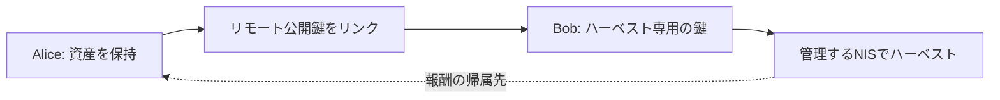

import Tabs from '@theme/Tabs';
import TabItem from '@theme/TabItem';

委任ハーベスティングでは、資産を持つアカウントの重要度を、専用のリモートアカウントに関連付けます。
資産をリモートアカウントへ送金する操作ではありません。SDKではこの操作を `account_key_link_transaction_v1` と呼びます。
NISのAPIや従来資料では Importance Transfer と呼ばれます。

## 8.1 専用アカウントを準備する

他の章と別の作業ディレクトリで[学習用アカウント](learning-accounts.mdx)を作成します。
Alice を資産を持つ元アカウント、未使用の Bob をリモートアカウントにします。Bob に資産を持たせたり、通常の送信に使ったりしないでください。

ハーベスティングには既得残高や重要度などの条件があり、リンクが成立しただけでは開始しません。
通常は10,000 XEM以上の既得残高が条件で、残高を入金した直後に全額が既得残高になるわけではありません。
反映までの待機とNISの状態を確認してください。



## 8.2 リモート公開鍵をリンク・解除する

`NEM_LINK_ACTION` の既定値は `link` です。解除は `unlink` を指定します。
同じリモート公開鍵を対象にし、現在のリンク状態と待機期間を確認してから実行してください。

<Tabs groupId="language">
<TabItem value="ts" label="TypeScript">

```ts title="src/harvesting/link-remote-account.ts"
import {
  NemFacade,
  descriptors,
  models,
  calculateTransactionFee,
  TransactionFactory,
} from 'symbol-sdk/nem';
import { alice, bob } from '../accounts/key-store.js';

const facade = new NemFacade('testnet');

const action = process.env.NEM_LINK_ACTION ?? 'link';

if (!['link', 'unlink'].includes(action))
  throw new Error('NEM_LINK_ACTION はlinkかunlinkです');

// 資産はAliceに残したまま、Bobの公開鍵を重要度の委任先として指定する。
const descriptor = new descriptors.AccountKeyLinkTransactionV1Descriptor(
  action === 'link' ? models.LinkAction.LINK : models.LinkAction.UNLINK,
  bob.publicKey,
);

const tx = facade.createTransactionFromTypedDescriptor(
  descriptor,
  alice.publicKey,
  0n,
  7200,
);

// 手数料を確定してから署名する。署名後に金額や期限を変更しない。
tx.fee = new models.Amount(calculateTransactionFee(tx));

const signature = alice.signTransaction(tx);

if (!facade.verifyTransaction(tx, signature))
  throw new Error('署名検証に失敗しました');

const body = TransactionFactory.attachSignature(tx, signature);

console.log(body);

console.log('hash:', facade.hashTransaction(tx).toString());
```

</TabItem>
<TabItem value="py" label="Python">

```py title="src/harvesting/link_remote_account.py"
import os
from symbolchain import nc
from symbolchain.facade.NemFacade import NemFacade
from symbolchain.nem.FeeCalculator import calculate_transaction_fee
from symbolchain.nem.TransactionFactory import TransactionFactory
from accounts.key_store import alice, bob

facade = NemFacade('testnet')

action = os.environ.get('NEM_LINK_ACTION', 'link')
if action not in ('link', 'unlink'):
    raise ValueError('NEM_LINK_ACTION はlinkかunlinkです')

# 資産はAliceに残したまま、Bobの公開鍵を重要度の委任先として指定する。
tx = facade.create_transaction_from_descriptor(
    {
        'type': 'account_key_link_transaction_v1',
        'link_action': action,
        'remote_public_key': bob.public_key,
    },
    alice.public_key,
    0,
    7200,
)

# 手数料を確定してから署名する。署名後に金額や期限を変更しない。
tx.fee = nc.Amount(calculate_transaction_fee(tx))
signature = alice.sign_transaction(tx)
if not facade.verify_transaction(tx, signature):
    raise ValueError('署名検証に失敗しました')

body = TransactionFactory.attach_signature(tx, signature)
print(body)
print('hash:', facade.hash_transaction(tx))
```

</TabItem>
</Tabs>

[送信手順](transactions.mdx#33-明示的に送信する)でアナウンスし、取り込み後に状態を照合します。

## 8.3 有効化の状態を確認する

<Tabs groupId="language">
<TabItem value="ts" label="TypeScript">

```ts title="src/harvesting/account-status.ts"
import JSONBig from 'json-bigint';
import { alice, bob } from '../accounts/key-store.js';

const node = process.env.NEM_NODE?.replace(/\/$/, '');

const json = JSONBig({ useNativeBigInt: true });

// 数値の桁を失わないよう、JSON.parseではなく64ビット対応のparserを使う。
async function get(path: string) {
  if (!node)
    throw new Error('NEM_NODE に NIS Testnet の REST URL を設定してください');
  const response = await fetch(`${node}${path}`, {
    signal: AbortSignal.timeout(15000),
  });
  if (!response.ok) throw new Error(`GET ${path}: HTTP ${response.status}`);
  return json.parse(await response.text());
}

// 取り込みとリモート状態を照合する。すぐに有効化されるとは限らない。
console.log('main:', await get(`/account/status?address=${alice.address}`));

console.log('remote:', await get(`/account/status?address=${bob.address}`));

console.log(
  'forwarded:',
  await get(`/account/get/forwarded?address=${bob.address}`),
);
```

</TabItem>
<TabItem value="py" label="Python">

```py title="src/harvesting/account_status.py"
import os
import requests
from accounts.key_store import alice, bob


# requests の JSON decoder は整数を Python の int として保持する。
def get(path):
    node = os.environ['NEM_NODE'].rstrip('/')
    response = requests.get(node + path, timeout=15)
    response.raise_for_status()
    return response.json()


# 取り込みとリモート状態を照合する。すぐに有効化されるとは限らない。
print('main:', get(f'/account/status?address={alice.address}'))
print('remote:', get(f'/account/status?address={bob.address}'))
print('forwarded:', get(f'/account/get/forwarded?address={bob.address}'))
```

</TabItem>
</Tabs>

`remoteStatus` などで有効化状態を確認します。NIS上でハーベストを始める手順は[ノードの構築・運用](../../node-operation/nem/setup.mdx)を参照してください。
リモートの秘密鍵を使うノード設定と、公開鍵のリンクは別の操作です。
元アカウントの秘密鍵を公開APIへ送らず、リモート用の秘密情報も自分が管理する環境で扱います。
解除してもNIS側の管理作業が不要になるわけではないため、稼働状態を確認して終了します。

## 参照資料

- [NEM SDK 3.3.3 の公式実装](https://github.com/symbol/symbol/tree/7c5bd51293c1202701d10daf2afcb6c060e45c30/sdk)
- [NIS API](https://nemproject.github.io/)
- [NEMのハーベスティング](https://docs.nemtest.net/ja/textbook/harvesting/)
