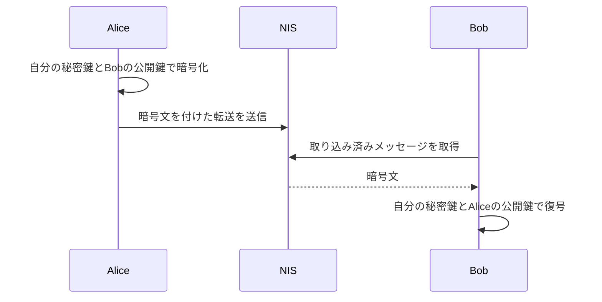

import Tabs from '@theme/Tabs';
import TabItem from '@theme/TabItem';

転送には平文または暗号化メッセージを付けられます。
NEMではメッセージ型を別フィールドで指定します。Symbolの平文メッセージ用 `0x00` を文字列の先頭へ付けません。

## 4.1 平文を付ける

`MessageDescriptor`／`message` に平文型とUTF-8のバイト列を指定します。内容は第三者にも読めるため、秘密情報を入れません。
メッセージの長さで手数料が増えるので、添付後に計算します。

<Tabs groupId="language">
<TabItem value="ts" label="TypeScript">

```ts title="src/messages/plain-message.ts"
import {
  NemFacade,
  descriptors,
  models,
  calculateTransactionFee,
  TransactionFactory,
} from 'symbol-sdk/nem';
import { alice, bob } from '../accounts/key-store.js';

const facade = new NemFacade('testnet');

const message = new descriptors.MessageDescriptor(
  models.MessageType.PLAIN,
  new TextEncoder().encode('Hello, NEM!'),
);

const descriptor = new descriptors.TransferTransactionV2Descriptor(
  bob.address,
  new models.Amount(1_000_000n),
  message,
);

const tx = facade.createTransactionFromTypedDescriptor(
  descriptor,
  alice.publicKey,
  0n,
  7200,
);

// 手数料を確定してから署名する。署名後に金額や期限を変更しない。
tx.fee = new models.Amount(calculateTransactionFee(tx));

const signature = alice.signTransaction(tx);

if (!facade.verifyTransaction(tx, signature))
  throw new Error('署名検証に失敗しました');

const body = TransactionFactory.attachSignature(tx, signature);

console.log(body);

console.log('hash:', facade.hashTransaction(tx).toString());
```

</TabItem>
<TabItem value="py" label="Python">

```py title="src/messages/plain_message.py"
from symbolchain import nc
from symbolchain.facade.NemFacade import NemFacade
from symbolchain.nem.FeeCalculator import calculate_transaction_fee
from symbolchain.nem.TransactionFactory import TransactionFactory
from accounts.key_store import alice, bob

facade = NemFacade('testnet')

descriptor = {
    'type': 'transfer_transaction_v2',
    'recipient_address': bob.address,
    'amount': 1_000_000,
    'message': {'message_type': 'plain', 'message': b'Hello, NEM!'},
}
tx = facade.create_transaction_from_descriptor(
    descriptor, alice.public_key, 0, 7200
)

# 手数料を確定してから署名する。署名後に金額や期限を変更しない。
tx.fee = nc.Amount(calculate_transaction_fee(tx))
signature = alice.sign_transaction(tx)
if not facade.verify_transaction(tx, signature):
    raise ValueError('署名検証に失敗しました')

body = TransactionFactory.attach_signature(tx, signature)
print(body)
print('hash:', facade.hash_transaction(tx))
```

</TabItem>
</Tabs>

## 4.2 公開鍵で暗号化する

Alice の秘密鍵と Bob の公開鍵で暗号化し、Bob の秘密鍵と Alice の公開鍵で復号します。
アドレスだけでは暗号化できません。相手の公開鍵を確認できる方法で入手してください。



次の例はSDK推奨のAES-GCM形式です。まず手元で復号が成功することを確認してから転送を作ります。

<Tabs groupId="language">
<TabItem value="ts" label="TypeScript">

```ts title="src/messages/encrypted-message.ts"
import {
  NemFacade,
  descriptors,
  models,
  calculateTransactionFee,
  TransactionFactory,
} from 'symbol-sdk/nem';
import { alice, bob } from '../accounts/key-store.js';

const facade = new NemFacade('testnet');

// 推奨形式で暗号化し、Bob の鍵で復号できることを確認する。
const encrypted = alice
  .messageEncoder()
  .encode(bob.publicKey, new TextEncoder().encode('Only Bob can read this.'));

const decoded = bob.messageEncoder().tryDecode(alice.publicKey, encrypted);

if (!decoded.isDecoded || !(decoded.message instanceof Uint8Array))
  throw new Error('復号に失敗しました');

console.log(new TextDecoder().decode(decoded.message));

const message = new descriptors.MessageDescriptor(
  encrypted.messageType,
  encrypted.message,
);

const tx = facade.createTransactionFromTypedDescriptor(
  new descriptors.TransferTransactionV2Descriptor(
    bob.address,
    new models.Amount(1_000_000n),
    message,
  ),
  alice.publicKey,
  0n,
  7200,
);

// 手数料を確定してから署名する。署名後に金額や期限を変更しない。
tx.fee = new models.Amount(calculateTransactionFee(tx));

const signature = alice.signTransaction(tx);

if (!facade.verifyTransaction(tx, signature))
  throw new Error('署名検証に失敗しました');

const body = TransactionFactory.attachSignature(tx, signature);

console.log(body);

console.log('hash:', facade.hashTransaction(tx).toString());
```

</TabItem>
<TabItem value="py" label="Python">

```py title="src/messages/encrypted_message.py"
from symbolchain import nc
from symbolchain.facade.NemFacade import NemFacade
from symbolchain.nem.FeeCalculator import calculate_transaction_fee
from symbolchain.nem.TransactionFactory import TransactionFactory
from accounts.key_store import alice, bob

facade = NemFacade('testnet')

# 推奨形式で暗号化し、Bob の鍵で復号できることを確認する。
encrypted = alice.message_encoder().encode(
    bob.public_key, b'Only Bob can read this.'
)
is_decoded, decoded = bob.message_encoder().try_decode(
    alice.public_key, encrypted
)
if not is_decoded:
    raise ValueError('復号に失敗しました')
print(decoded.decode('utf8'))

tx = facade.create_transaction_from_descriptor(
    {
        'type': 'transfer_transaction_v2',
        'recipient_address': bob.address,
        'amount': 1_000_000,
        'message': {
            'message_type': encrypted.message_type,
            'message': encrypted.message,
        },
    },
    alice.public_key,
    0,
    7200,
)

# 手数料を確定してから署名する。署名後に金額や期限を変更しない。
tx.fee = nc.Amount(calculate_transaction_fee(tx))
signature = alice.sign_transaction(tx)
if not facade.verify_transaction(tx, signature):
    raise ValueError('署名検証に失敗しました')

body = TransactionFactory.attach_signature(tx, signature)
print(body)
print('hash:', facade.hash_transaction(tx))
```

</TabItem>
</Tabs>

`tryDecode`／`try_decode` は復号の成否も返します。失敗した暗号文を平文として処理しないでください。
暗号化しても送受信者や金額は隠れません。

## 4.3 旧ウォレットとの互換性

旧来のNEMウォレットはAES-CBC形式を使うため、SDK推奨のGCM形式を表示できない場合があります。
`encodeDeprecated`／`encode_deprecated` は旧形式を生成する互換APIです。新規の実装は `encode` を使い、
ウォレットとの連携では双方の対応形式を確認してください。SDKは復号時に旧形式も試みますが、読み取れない場合は失敗として扱います。
実際のウォレットとの相互運用は、SDK同士の復号テストと別に確認してください。

## 参照資料

- [NEM SDK 3.3.3 の公式実装](https://github.com/symbol/symbol/tree/7c5bd51293c1202701d10daf2afcb6c060e45c30/sdk)
- [NIS API](https://nemproject.github.io/)
- [NEM MessageEncoder](https://github.com/symbol/symbol/blob/7c5bd51293c1202701d10daf2afcb6c060e45c30/sdk/javascript/src/nem/MessageEncoder.js)
