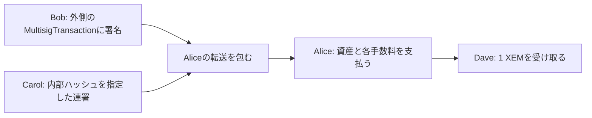

import Tabs from '@theme/Tabs';
import TabItem from '@theme/TabItem';

マルチシグ化したアカウントは、登録した連署者が承認します。Alice 自身の秘密鍵だけでは転送できなくなります。
別の作業ディレクトリで[学習用アカウント](learning-accounts.mdx)を用意し、Alice を対象、Bob と Carol を連署者、Dave を受信者にします。

## 7.1 Alice を2-of-2にする

通常アカウントの Alice が、Bob と Carol の公開鍵を登録します。
NEMの初回変更は Alice の署名で行い、Symbolの初期マルチシグ登録のように新しい連署者の同意署名を付ける形式ではありません。
公開鍵を取り違えると操作できなくなるため、本人との照合を済ませてください。

<Tabs groupId="language">
<TabItem value="ts" label="TypeScript">

```ts title="src/multisig/create-multisig.ts"
import {
  NemFacade,
  descriptors,
  models,
  calculateTransactionFee,
  TransactionFactory,
} from 'symbol-sdk/nem';
import { alice, bob, carol } from '../accounts/key-store.js';

const facade = new NemFacade('testnet');

// 連署者2人を追加し、必要承認数を0から2へ増やす。
const modifications = [bob, carol].map(
  (account) =>
    new descriptors.SizePrefixedMultisigAccountModificationDescriptor(
      new descriptors.MultisigAccountModificationDescriptor(
        models.MultisigAccountModificationType.ADD_COSIGNATORY,
        account.publicKey,
      ),
    ),
);

const tx = facade.createTransactionFromTypedDescriptor(
  new descriptors.MultisigAccountModificationTransactionV2Descriptor(
    2,
    modifications,
  ),
  alice.publicKey,
  0n,
  7200,
);

// 手数料を確定してから署名する。署名後に金額や期限を変更しない。
tx.fee = new models.Amount(calculateTransactionFee(tx));

const signature = alice.signTransaction(tx);

if (!facade.verifyTransaction(tx, signature))
  throw new Error('署名検証に失敗しました');

const body = TransactionFactory.attachSignature(tx, signature);

console.log(body);

console.log('hash:', facade.hashTransaction(tx).toString());
```

</TabItem>
<TabItem value="py" label="Python">

```py title="src/multisig/create_multisig.py"
from symbolchain import nc
from symbolchain.facade.NemFacade import NemFacade
from symbolchain.nem.FeeCalculator import calculate_transaction_fee
from symbolchain.nem.TransactionFactory import TransactionFactory
from accounts.key_store import alice, bob, carol

facade = NemFacade('testnet')

# 連署者2人を追加し、必要承認数を0から2へ増やす。
modifications = [
    {
        'modification': {
            'modification_type': 'add_cosignatory',
            'cosignatory_public_key': account.public_key,
        }
    }
    for account in (bob, carol)
]
tx = facade.create_transaction_from_descriptor(
    {
        'type': 'multisig_account_modification_transaction_v2',
        'min_approval_delta': 2,
        'modifications': modifications,
    },
    alice.public_key,
    0,
    7200,
)

# 手数料を確定してから署名する。署名後に金額や期限を変更しない。
tx.fee = nc.Amount(calculate_transaction_fee(tx))
signature = alice.sign_transaction(tx)
if not facade.verify_transaction(tx, signature):
    raise ValueError('署名検証に失敗しました')

body = TransactionFactory.attach_signature(tx, signature)
print(body)
print('hash:', facade.hash_transaction(tx))
```

</TabItem>
</Tabs>

署名済みJSONを[送信](transactions.mdx#33-明示的に送信する)し、取り込み後に `GET /account/get?address={Aliceのアドレス}` の
`meta.cosignatories` と `account.multisigInfo.minCosignatories` を確認します。
`minApprovalDelta`／`min_approval_delta` は現在値からの差分です。

## 7.2 Bob が転送を起案する

Alice を署名者に指定した転送を作り、署名部分を持たない形式に変換して外側の MultisigTransaction へ入れます。
外側には Bob が署名し、Carol は**内部トランザクションのハッシュ**を対象に連署します。
NEMでは内部・外側・連署トランザクションそれぞれに手数料があり、対象の Alice が負担します。
Bob や Carol の口座から差し引く前提で残高を確認しないでください。



<Tabs groupId="language">
<TabItem value="ts" label="TypeScript">

```ts title="src/multisig/prepare-transfer.ts"
import { existsSync, writeFileSync } from 'node:fs';
import {
  NemFacade,
  descriptors,
  models,
  calculateTransactionFee,
  TransactionFactory,
} from 'symbol-sdk/nem';
import { alice, bob, dave } from '../accounts/key-store.js';

const facade = new NemFacade('testnet');

if (
  ['multisig.bin', 'multisig-payload.json'].some((path) => existsSync(path))
)
  throw new Error('既存の起案データがあります');

// 内部の送信者はAliceだが、Aliceの署名は付けない。
const inner = facade.createTransactionFromTypedDescriptor(
  new descriptors.TransferTransactionV2Descriptor(
    dave.address,
    new models.Amount(1_000_000n),
  ),
  alice.publicKey,
  0n,
  7200,
);

inner.fee = new models.Amount(calculateTransactionFee(inner));

const tx = facade.createTransactionFromTypedDescriptor(
  new descriptors.MultisigTransactionV1Descriptor(
    TransactionFactory.toNonVerifiableTransaction(inner),
  ),
  bob.publicKey,
  0n,
  7200,
);

tx.fee = new models.Amount(calculateTransactionFee(tx));

// 起案者Bobが外側に署名する。連署対象はinnerHashになる。
const signature = bob.signTransaction(tx);

if (!facade.verifyTransaction(tx, signature))
  throw new Error('起案者の署名が不正です');

writeFileSync(
  'multisig-payload.json',
  TransactionFactory.attachSignature(tx, signature),
  { flag: 'wx' },
);

writeFileSync('multisig.bin', tx.serialize(), { flag: 'wx' });

console.log('outerHash:', facade.hashTransaction(tx).toString());

console.log('innerHash:', facade.hashTransaction(inner).toString());
```

</TabItem>
<TabItem value="py" label="Python">

```py title="src/multisig/prepare_transfer.py"
from pathlib import Path
from symbolchain import nc
from symbolchain.facade.NemFacade import NemFacade
from symbolchain.nem.FeeCalculator import calculate_transaction_fee
from symbolchain.nem.TransactionFactory import TransactionFactory
from accounts.key_store import alice, bob, dave

facade = NemFacade('testnet')

if any(
    Path(path).exists() for path in ('multisig.bin', 'multisig-payload.json')
):
    raise FileExistsError('既存の起案データがあります')

# 内部の送信者はAliceだが、Aliceの署名は付けない。
inner = facade.create_transaction_from_descriptor(
    {
        'type': 'transfer_transaction_v2',
        'recipient_address': dave.address,
        'amount': 1_000_000,
    },
    alice.public_key,
    0,
    7200,
)
inner.fee = nc.Amount(calculate_transaction_fee(inner))
tx = facade.create_transaction_from_descriptor(
    {
        'type': 'multisig_transaction_v1',
        'inner_transaction': TransactionFactory.to_non_verifiable_transaction(
            inner
        ),
    },
    bob.public_key,
    0,
    7200,
)
tx.fee = nc.Amount(calculate_transaction_fee(tx))

# 起案者Bobが外側に署名する。連署対象はinnerHashになる。
signature = bob.sign_transaction(tx)
if not facade.verify_transaction(tx, signature):
    raise ValueError('起案者の署名が不正です')
with Path('multisig-payload.json').open('x', encoding='utf8') as file:
    file.write(TransactionFactory.attach_signature(tx, signature))
with Path('multisig.bin').open('xb') as file:
    file.write(tx.serialize())
print('outerHash:', facade.hash_transaction(tx))
print('innerHash:', facade.hash_transaction(inner))
```

</TabItem>
</Tabs>

## 7.3 Carol が連署する

Carol は `multisig.bin` の内部の送受信者・金額・期限・手数料を確認します。
次の例は引数なしで内容と連署対象のハッシュを表示し、`--approve` を付けた場合だけ連署JSONを保存します。

<Tabs groupId="language">
<TabItem value="ts" label="TypeScript">

```ts title="src/multisig/create-cosignature.ts"
import { readFileSync, writeFileSync } from 'node:fs';
import { keccak_256 } from '@noble/hashes/sha3.js';
import { Hash256 } from 'symbol-sdk';
import {
  NemFacade,
  descriptors,
  models,
  TransactionFactory,
  calculateTransactionFee,
} from 'symbol-sdk/nem';
import { alice, bob, carol } from '../accounts/key-store.js';

const facade = new NemFacade('testnet');

const proposal = TransactionFactory.deserialize(
  new Uint8Array(readFileSync('multisig.bin')),
);

// 起案者の署名・ネットワーク・期限を確認してから、内部データを読む。
if (
  proposal.type.value !== models.TransactionType.MULTISIG.value ||
  proposal.network.value !== 152 ||
  proposal.signerPublicKey.toString() !== bob.publicKey.toString() ||
  !facade.verifyTransaction(proposal, proposal.signature) ||
  BigInt(proposal.deadline.value) <= facade.now().timestamp
) {
  throw new Error('有効なBobの起案ではありません');
}

const outer = proposal as models.MultisigTransactionV1;

if (
  outer.innerTransaction.signerPublicKey.toString() !==
    alice.publicKey.toString() ||
  outer.innerTransaction.network.value !== 152 ||
  BigInt(outer.innerTransaction.deadline.value) <= facade.now().timestamp
) {
  throw new Error(
    '内部トランザクションの署名者・ネットワーク・期限が不正です',
  );
}

// NEMのハッシュはKeccak-256。内部は非検証形式のバイト列を使う。
const innerHash = new Hash256(keccak_256(outer.innerTransaction.serialize()));

console.log(JSON.stringify(outer.toJson(), null, 2));

console.log('innerHash:', innerHash.toString());

if (process.argv.includes('--approve')) {
  const tx = facade.createTransactionFromTypedDescriptor(
    new descriptors.CosignatureV1Descriptor(innerHash, alice.address),
    carol.publicKey,
    0n,
    7200,
  );
  tx.fee = new models.Amount(calculateTransactionFee(tx));
  const signature = carol.signTransaction(tx);
  if (!facade.verifyTransaction(tx, signature))
    throw new Error('連署の署名検証に失敗しました');
  writeFileSync(
    'cosignature.json',
    TransactionFactory.attachSignature(tx, signature),
    { flag: 'wx' },
  );
}
```

</TabItem>
<TabItem value="py" label="Python">

```py title="src/multisig/create_cosignature.py"
import sys
import json
import sha3
from pathlib import Path
from symbolchain import nc
from symbolchain.CryptoTypes import Hash256
from symbolchain.facade.NemFacade import NemFacade
from symbolchain.nem.TransactionFactory import TransactionFactory
from symbolchain.nem.FeeCalculator import calculate_transaction_fee
from accounts.key_store import alice, bob, carol

facade = NemFacade('testnet')
outer = TransactionFactory.deserialize(Path('multisig.bin').read_bytes())

# 起案者の署名・ネットワーク・期限を確認してから、内部データを読む。
if (
    outer.type_ != nc.TransactionType.MULTISIG
    or outer.network.value != 152
    or str(outer.signer_public_key) != str(bob.public_key)
    or not facade.verify_transaction(outer, outer.signature)
    or outer.deadline.value <= facade.now().timestamp
):
    raise ValueError('有効なBobの起案ではありません')
inner = outer.inner_transaction
if (
    str(inner.signer_public_key) != str(alice.public_key)
    or inner.network.value != 152
    or inner.deadline.value <= facade.now().timestamp
):
    raise ValueError(
        '内部トランザクションの署名者・ネットワーク・期限が不正です'
    )

# NEMのハッシュはKeccak-256。内部は非検証形式のバイト列を使う。
inner_hash = Hash256(sha3.keccak_256(inner.serialize()).digest())
print(json.dumps(outer.to_json(), indent=2))
print('innerHash:', inner_hash)

if '--approve' in sys.argv:
    tx = facade.create_transaction_from_descriptor(
        {
            'type': 'cosignature_v1',
            'other_transaction_hash': inner_hash,
            'multisig_account_address': alice.address,
        },
        carol.public_key,
        0,
        7200,
    )
    tx.fee = nc.Amount(calculate_transaction_fee(tx))
    signature = carol.sign_transaction(tx)
    if not facade.verify_transaction(tx, signature):
        raise ValueError('連署の署名検証に失敗しました')
    with Path('cosignature.json').open('x', encoding='utf8') as file:
        file.write(TransactionFactory.attach_signature(tx, signature))
```

</TabItem>
</Tabs>

先に `multisig-payload.json` を通常の送信スクリプトで送り、受付後に `cosignature.json` を送ります。
外側だけでは取り込まれないため、Carol の連署まで送ってから取り込みを待ちます。

```bash
# TypeScript
node dist/transactions/announce.js multisig-payload.json --announce
node dist/transactions/announce.js cosignature.json --announce

# Python
PYTHONPATH=src python src/transactions/announce.py multisig-payload.json --announce
PYTHONPATH=src python src/transactions/announce.py cosignature.json --announce
```

必要な署名がそろうと、Alice から Dave への転送が取り込み可能になります。
内部ハッシュと外側ハッシュを保存し、[監視](observer.mdx)の履歴や未承認情報も照合します。

## 7.4 Carol を Dave に差し替える

内部の変更トランザクションを Alice 名義で作り、外側は Bob が起案します。
変更前の2-of-2を満たすため Carol の連署も必要です。閾値を2に保つので差分は0です。

<Tabs groupId="language">
<TabItem value="ts" label="TypeScript">

```ts title="src/multisig/change-cosigners.ts"
import { existsSync, writeFileSync } from 'node:fs';
import {
  NemFacade,
  descriptors,
  models,
  calculateTransactionFee,
  TransactionFactory,
} from 'symbol-sdk/nem';
import { alice, bob, carol, dave } from '../accounts/key-store.js';

const facade = new NemFacade('testnet');

if (
  ['multisig.bin', 'multisig-payload.json'].some((path) => existsSync(path))
)
  throw new Error('既存の起案データがあります');

const modifications = [
  new descriptors.SizePrefixedMultisigAccountModificationDescriptor(
    new descriptors.MultisigAccountModificationDescriptor(
      models.MultisigAccountModificationType.DELETE_COSIGNATORY,
      carol.publicKey,
    ),
  ),
  new descriptors.SizePrefixedMultisigAccountModificationDescriptor(
    new descriptors.MultisigAccountModificationDescriptor(
      models.MultisigAccountModificationType.ADD_COSIGNATORY,
      dave.publicKey,
    ),
  ),
];

// 閾値の差分は0。変更前のBobとCarolの承認を集める。
const inner = facade.createTransactionFromTypedDescriptor(
  new descriptors.MultisigAccountModificationTransactionV2Descriptor(
    0,
    modifications,
  ),
  alice.publicKey,
  0n,
  7200,
);

inner.fee = new models.Amount(calculateTransactionFee(inner));

const tx = facade.createTransactionFromTypedDescriptor(
  new descriptors.MultisigTransactionV1Descriptor(
    TransactionFactory.toNonVerifiableTransaction(inner),
  ),
  bob.publicKey,
  0n,
  7200,
);

tx.fee = new models.Amount(calculateTransactionFee(tx));

const signature = bob.signTransaction(tx);

if (!facade.verifyTransaction(tx, signature))
  throw new Error('起案者の署名が不正です');

writeFileSync(
  'multisig-payload.json',
  TransactionFactory.attachSignature(tx, signature),
  { flag: 'wx' },
);

writeFileSync('multisig.bin', tx.serialize(), { flag: 'wx' });
```

</TabItem>
<TabItem value="py" label="Python">

```py title="src/multisig/change_cosigners.py"
from pathlib import Path
from symbolchain import nc
from symbolchain.facade.NemFacade import NemFacade
from symbolchain.nem.FeeCalculator import calculate_transaction_fee
from symbolchain.nem.TransactionFactory import TransactionFactory
from accounts.key_store import alice, bob, carol, dave

facade = NemFacade('testnet')

if any(
    Path(path).exists() for path in ('multisig.bin', 'multisig-payload.json')
):
    raise FileExistsError('既存の起案データがあります')
modifications = [
    {
        'modification': {
            'modification_type': 'delete_cosignatory',
            'cosignatory_public_key': carol.public_key,
        }
    },
    {
        'modification': {
            'modification_type': 'add_cosignatory',
            'cosignatory_public_key': dave.public_key,
        }
    },
]

# 閾値の差分は0。変更前のBobとCarolの承認を集める。
inner = facade.create_transaction_from_descriptor(
    {
        'type': 'multisig_account_modification_transaction_v2',
        'min_approval_delta': 0,
        'modifications': modifications,
    },
    alice.public_key,
    0,
    7200,
)
inner.fee = nc.Amount(calculate_transaction_fee(inner))
tx = facade.create_transaction_from_descriptor(
    {
        'type': 'multisig_transaction_v1',
        'inner_transaction': TransactionFactory.to_non_verifiable_transaction(
            inner
        ),
    },
    bob.public_key,
    0,
    7200,
)
tx.fee = nc.Amount(calculate_transaction_fee(tx))
signature = bob.sign_transaction(tx)
if not facade.verify_transaction(tx, signature):
    raise ValueError('起案者の署名が不正です')
with Path('multisig-payload.json').open('x', encoding='utf8') as file:
    file.write(TransactionFactory.attach_signature(tx, signature))
with Path('multisig.bin').open('xb') as file:
    file.write(tx.serialize())
```

</TabItem>
</Tabs>

既存の起案データとは別の作業ディレクトリで保存するか、確認済みのデータを安全な場所へ移してから生成します。
前節の連署スクリプトで Carol の承認を作り、外側と連署を送信して取り込みを確認します。
新しく加わる Dave の鍵を事前に照合してください。連署者の鍵を失い必要数を満たせなくなると、変更や復旧もできません。

## 参照資料

- [NEM SDK 3.3.3 の公式実装](https://github.com/symbol/symbol/tree/7c5bd51293c1202701d10daf2afcb6c060e45c30/sdk)
- [NIS API](https://nemproject.github.io/)
- [NISのMultisigTransaction](https://github.com/NemProject/nem/blob/v0.6.102/core/src/main/java/org/nem/core/model/MultisigTransaction.java)
- [NISの連署トランザクション](https://github.com/NemProject/nem/blob/v0.6.102/core/src/main/java/org/nem/core/model/MultisigSignatureTransaction.java)
