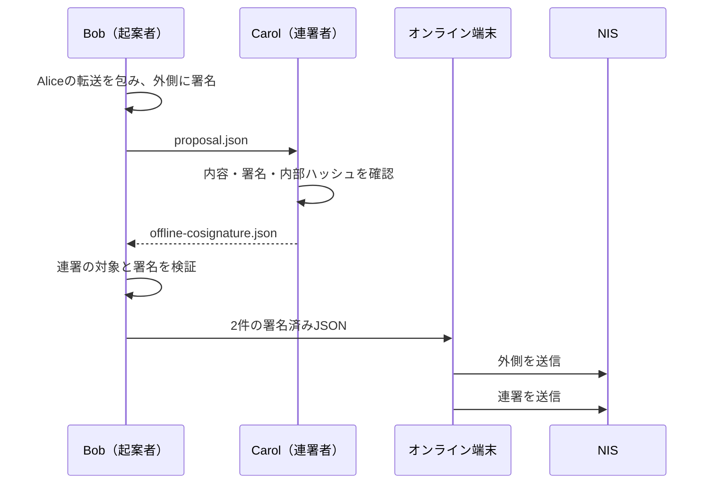

import Tabs from '@theme/Tabs';
import TabItem from '@theme/TabItem';

マルチシグの起案と連署をオフライン端末で作り、オンライン端末からNISへ送ります。
[マルチシグ](multisig.mdx)で作った Alice の2-of-2を使い、Bob が起案、Carol が連署します。
運用時は各担当者が自分の鍵だけを保持し、秘密鍵やニーモニックを受け渡しません。



## 10.1 Bob が提案データを用意する

[マルチシグ転送の起案](multisig.mdx#72-bob-が転送を起案する)で `multisig.bin` を生成します。
次の例でBobの署名を検証し、受け渡し用の `proposal.json` に保存します。
これはNISへ送る `data`／`signature` 形式とは別の、SDKでの復元用データです。

<Tabs groupId="language">
<TabItem value="ts" label="TypeScript">

```ts title="src/offline-signature/export-proposal.ts"
import { readFileSync, writeFileSync } from 'node:fs';
import { utils } from 'symbol-sdk';
import { NemFacade, models, TransactionFactory } from 'symbol-sdk/nem';
import { bob } from '../accounts/key-store.js';

const facade = new NemFacade('testnet');

const bytes = new Uint8Array(readFileSync('multisig.bin'));

const tx = TransactionFactory.deserialize(bytes);

// Bobの有効なマルチシグ起案を、署名を含むSDK形式で受け渡す。
if (
  tx.type.value !== models.TransactionType.MULTISIG.value ||
  tx.network.value !== 152 ||
  tx.signerPublicKey.toString() !== bob.publicKey.toString() ||
  !facade.verifyTransaction(tx, tx.signature)
) {
  throw new Error('有効なBobの起案ではありません');
}

writeFileSync(
  'proposal.json',
  JSON.stringify({ transaction: utils.uint8ToHex(bytes) }),
  { flag: 'wx' },
);
```

</TabItem>
<TabItem value="py" label="Python">

```py title="src/offline_signature/export_proposal.py"
import json
from pathlib import Path
from symbolchain import nc
from symbolchain.facade.NemFacade import NemFacade
from symbolchain.nem.TransactionFactory import TransactionFactory
from accounts.key_store import bob

facade = NemFacade('testnet')
raw = Path('multisig.bin').read_bytes()
tx = TransactionFactory.deserialize(raw)

# Bobの有効なマルチシグ起案を、署名を含むSDK形式で受け渡す。
if (
    tx.type_ != nc.TransactionType.MULTISIG
    or tx.network.value != 152
    or str(tx.signer_public_key) != str(bob.public_key)
    or not facade.verify_transaction(tx, tx.signature)
):
    raise ValueError('有効なBobの起案ではありません')
with Path('proposal.json').open('x', encoding='utf8') as file:
    json.dump({'transaction': raw.hex().upper()}, file)
```

</TabItem>
</Tabs>

## 10.2 Carol が内容を確認して連署する

別の経路で内部ハッシュも照合し、Alice の送金先・金額・手数料・期限を確認します。
引数なしで内容を表示し、同意した場合だけ `--approve` を付けて再実行します。
連署は外側のハッシュに対する単純な署名ではなく、内部ハッシュと対象アドレスを含む別のトランザクションです。

<Tabs groupId="language">
<TabItem value="ts" label="TypeScript">

```ts title="src/offline-signature/approve-proposal.ts"
import { readFileSync, writeFileSync } from 'node:fs';
import { keccak_256 } from '@noble/hashes/sha3.js';
import { Hash256, utils } from 'symbol-sdk';
import {
  NemFacade,
  descriptors,
  models,
  TransactionFactory,
  calculateTransactionFee,
} from 'symbol-sdk/nem';
import { alice, bob, carol } from '../accounts/key-store.js';

const facade = new NemFacade('testnet');

const proposal = TransactionFactory.deserialize(
  utils.hexToUint8(
    JSON.parse(readFileSync('proposal.json', 'utf8')).transaction,
  ),
);

// 起案者の署名・ネットワーク・期限を確認してから、内部データを読む。
if (
  proposal.type.value !== models.TransactionType.MULTISIG.value ||
  proposal.network.value !== 152 ||
  proposal.signerPublicKey.toString() !== bob.publicKey.toString() ||
  !facade.verifyTransaction(proposal, proposal.signature) ||
  BigInt(proposal.deadline.value) <= facade.now().timestamp
) {
  throw new Error('有効なBobの起案ではありません');
}

const outer = proposal as models.MultisigTransactionV1;

if (
  outer.innerTransaction.signerPublicKey.toString() !==
    alice.publicKey.toString() ||
  outer.innerTransaction.network.value !== 152 ||
  BigInt(outer.innerTransaction.deadline.value) <= facade.now().timestamp
) {
  throw new Error(
    '内部トランザクションの署名者・ネットワーク・期限が不正です',
  );
}

// NEMのハッシュはKeccak-256。内部は非検証形式のバイト列を使う。
const innerHash = new Hash256(keccak_256(outer.innerTransaction.serialize()));

console.log(JSON.stringify(outer.toJson(), null, 2));

console.log('innerHash:', innerHash.toString());

if (process.argv.includes('--approve')) {
  const tx = facade.createTransactionFromTypedDescriptor(
    new descriptors.CosignatureV1Descriptor(innerHash, alice.address),
    carol.publicKey,
    0n,
    7200,
  );
  tx.fee = new models.Amount(calculateTransactionFee(tx));
  const signature = carol.signTransaction(tx);
  if (!facade.verifyTransaction(tx, signature))
    throw new Error('連署の署名検証に失敗しました');
  writeFileSync(
    'offline-cosignature.json',
    TransactionFactory.attachSignature(tx, signature),
    { flag: 'wx' },
  );
}
```

</TabItem>
<TabItem value="py" label="Python">

```py title="src/offline_signature/approve_proposal.py"
import sys
import json
import sha3
from pathlib import Path
from symbolchain import nc
from symbolchain.CryptoTypes import Hash256
from symbolchain.facade.NemFacade import NemFacade
from symbolchain.nem.TransactionFactory import TransactionFactory
from symbolchain.nem.FeeCalculator import calculate_transaction_fee
from accounts.key_store import alice, bob, carol

facade = NemFacade('testnet')
outer = TransactionFactory.deserialize(
    bytes.fromhex(
        json.loads(Path('proposal.json').read_text(encoding='utf8'))[
            'transaction'
        ]
    )
)

# 起案者の署名・ネットワーク・期限を確認してから、内部データを読む。
if (
    outer.type_ != nc.TransactionType.MULTISIG
    or outer.network.value != 152
    or str(outer.signer_public_key) != str(bob.public_key)
    or not facade.verify_transaction(outer, outer.signature)
    or outer.deadline.value <= facade.now().timestamp
):
    raise ValueError('有効なBobの起案ではありません')
inner = outer.inner_transaction
if (
    str(inner.signer_public_key) != str(alice.public_key)
    or inner.network.value != 152
    or inner.deadline.value <= facade.now().timestamp
):
    raise ValueError(
        '内部トランザクションの署名者・ネットワーク・期限が不正です'
    )

# NEMのハッシュはKeccak-256。内部は非検証形式のバイト列を使う。
inner_hash = Hash256(sha3.keccak_256(inner.serialize()).digest())
print(json.dumps(outer.to_json(), indent=2))
print('innerHash:', inner_hash)

if '--approve' in sys.argv:
    tx = facade.create_transaction_from_descriptor(
        {
            'type': 'cosignature_v1',
            'other_transaction_hash': inner_hash,
            'multisig_account_address': alice.address,
        },
        carol.public_key,
        0,
        7200,
    )
    tx.fee = nc.Amount(calculate_transaction_fee(tx))
    signature = carol.sign_transaction(tx)
    if not facade.verify_transaction(tx, signature):
        raise ValueError('連署の署名検証に失敗しました')
    with Path('offline-cosignature.json').open('x', encoding='utf8') as file:
        file.write(TransactionFactory.attach_signature(tx, signature))
```

</TabItem>
</Tabs>

## 10.3 Bob が連署を検証する

Bob が保管する元の `multisig.bin` と、Carol から返された `offline-cosignature.json` を照合します。
署名者、ネットワーク、期限、内部ハッシュ、対象アドレスが一致していることを確認します。

<Tabs groupId="language">
<TabItem value="ts" label="TypeScript">

```ts title="src/offline-signature/verify-cosignature.ts"
import { readFileSync } from 'node:fs';
import { keccak_256 } from '@noble/hashes/sha3.js';
import { Hash256, PublicKey, Signature, utils } from 'symbol-sdk';
import {
  NemFacade,
  models,
  TransactionFactory,
  Verifier,
} from 'symbol-sdk/nem';
import { alice, bob, carol } from '../accounts/key-store.js';

const facade = new NemFacade('testnet');

const proposal = TransactionFactory.deserialize(
  new Uint8Array(readFileSync('multisig.bin')),
);

if (
  proposal.type.value !== models.TransactionType.MULTISIG.value ||
  proposal.network.value !== 152 ||
  proposal.signerPublicKey.toString() !== bob.publicKey.toString() ||
  !facade.verifyTransaction(proposal, proposal.signature) ||
  BigInt(proposal.deadline.value) <= facade.now().timestamp
)
  throw new Error('起案が不正または期限切れです');

const outer = proposal as models.MultisigTransactionV1;

const expected = new Hash256(keccak_256(outer.innerTransaction.serialize()));

const payload = JSON.parse(readFileSync('offline-cosignature.json', 'utf8'));

const data = utils.hexToUint8(payload.data);

const raw = models.NonVerifiableTransactionFactory.deserialize(data);

if (raw.type.value !== models.TransactionType.MULTISIG_COSIGNATURE.value)
  throw new Error('連署トランザクションではありません');

const cosig = raw as models.NonVerifiableCosignatureV1;

// JSON内の署名と、元の内部トランザクションへの参照を別々に照合する。
if (
  cosig.network.value !== 152 ||
  cosig.signerPublicKey.toString() !== carol.publicKey.toString() ||
  cosig.otherTransactionHash.toString() !== expected.toString() ||
  new TextDecoder().decode(cosig.multisigAccountAddress.bytes) !==
    alice.address.toString() ||
  BigInt(cosig.deadline.value) <= facade.now().timestamp ||
  !new Verifier(new PublicKey(cosig.signerPublicKey.bytes)).verify(
    data,
    new Signature(payload.signature),
  )
) {
  throw new Error('連署の対象・署名者・署名が一致しません');
}

console.log('verified innerHash:', expected.toString());
```

</TabItem>
<TabItem value="py" label="Python">

```py title="src/offline_signature/verify_cosignature.py"
import json
import sha3
from pathlib import Path
from symbolchain import nc
from symbolchain.CryptoTypes import Hash256, PublicKey, Signature
from symbolchain.facade.NemFacade import NemFacade
from symbolchain.nem.KeyPair import Verifier
from symbolchain.nem.TransactionFactory import TransactionFactory
from accounts.key_store import alice, bob, carol

facade = NemFacade('testnet')
outer = TransactionFactory.deserialize(Path('multisig.bin').read_bytes())
if (
    outer.type_ != nc.TransactionType.MULTISIG
    or outer.network.value != 152
    or str(outer.signer_public_key) != str(bob.public_key)
    or not facade.verify_transaction(outer, outer.signature)
    or outer.deadline.value <= facade.now().timestamp
):
    raise ValueError('起案が不正または期限切れです')
expected = Hash256(
    sha3.keccak_256(outer.inner_transaction.serialize()).digest()
)
payload = json.loads(
    Path('offline-cosignature.json').read_text(encoding='utf8')
)
data = bytes.fromhex(payload['data'])
cosig = nc.NonVerifiableTransactionFactory.deserialize(data)
if cosig.type_ != nc.TransactionType.MULTISIG_COSIGNATURE:
    raise ValueError('連署トランザクションではありません')

# JSON内の署名と、元の内部トランザクションへの参照を別々に照合する。
if (
    cosig.network.value != 152
    or str(cosig.signer_public_key) != str(carol.public_key)
    or str(cosig.other_transaction_hash) != str(expected)
    or cosig.multisig_account_address.bytes.decode('utf8')
    != str(alice.address)
    or cosig.deadline.value <= facade.now().timestamp
    or not Verifier(PublicKey(cosig.signer_public_key.bytes)).verify(
        data, Signature(payload['signature'])
    )
):
    raise ValueError('連署の対象・署名者・署名が一致しません')
print('verified innerHash:', expected)
```

</TabItem>
</Tabs>

検証後、オンライン端末へ `multisig-payload.json` と `offline-cosignature.json` を渡します。
[送信スクリプト](transactions.mdx#33-明示的に送信する)で外側を先に送り、受付後に連署を送ります。
SDKの `toJson`／`to_json` は非検証形式の送信用 `data` を作るため、
モデルの `cosignatures` 配列へ追加しただけで連署も自動送信されるとは考えないでください。

```bash
node dist/transactions/announce.js multisig-payload.json --announce
node dist/transactions/announce.js offline-cosignature.json --announce

# Python
PYTHONPATH=src python src/transactions/announce.py multisig-payload.json --announce
PYTHONPATH=src python src/transactions/announce.py offline-cosignature.json --announce
```

取り込みまで期限が進みます。期限切れなら起案を作り直し、新しい内部ハッシュに対する連署も集め直します。
受け渡したファイルに秘密鍵は不要ですが、署名済みデータは第三者が送信できるため、承認済みの取引として管理してください。

## 参照資料

- [NEM SDK 3.3.3 の公式実装](https://github.com/symbol/symbol/tree/7c5bd51293c1202701d10daf2afcb6c060e45c30/sdk)
- [NIS API](https://nemproject.github.io/)
- [NEM送信用JSONの生成](https://github.com/symbol/symbol/blob/7c5bd51293c1202701d10daf2afcb6c060e45c30/sdk/javascript/src/nem/TransactionFactory.js)
