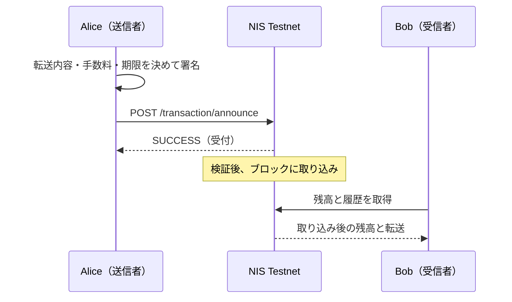

import Tabs from '@theme/Tabs';
import TabItem from '@theme/TabItem';

トランザクションは、送信者が署名した処理の要求です。NEMではXEMの転送、モザイク発行、マルチシグ構成変更などに使います。
[学習用アカウント](learning-accounts.mdx)の Alice から Bob へ1 XEMを送ります。
通常の転送には Alice の署名だけが必要で、Bob の署名は不要です。



## 3.1 構築に必要な値

| 項目 | NEMでの指定 |
| --- | --- |
| 宛先 | 40文字のNEM Testnetアドレス |
| 金額 | モザイク指定なしの転送ではXEMの最小単位。`1_000_000` が1 XEM |
| 時刻と期限 | NEMのネットワーク時刻は秒単位。SDKが現在時刻と2時間後の期限を設定 |
| 手数料 | XEMの最小単位の金額。Symbolの手数料係数を渡さない |
| 署名者 | Alice の公開鍵。秘密鍵を descriptor に含めない |

TypeScript は `descriptors.TransferTransactionV2Descriptor`、Python は `type` を含む辞書を使います。
`createTransactionFromTypedDescriptor`／`create_transaction_from_descriptor` の第3引数は手数料の**金額**です。
まず0で構築し、`calculateTransactionFee`／`calculate_transaction_fee` で求めた金額を署名前に設定します。
Python のこの構築メソッドは3.3.3で追加されました。

OSの時刻を正しく合わせてください。`GET /time-sync/network-time` の `receiveTimeStamp` はミリ秒なので、
SDKの秒単位の時刻と照合する場合は1,000で割ります。期限は取り込み待ちの上限で、取り込み時刻の予約ではありません。

## 3.2 転送を構築して署名する

メッセージなしの1 XEM転送の手数料は SDK 3.3.3 の計算では0.05 XEMです。
金額に加え、この手数料を賄う残高が必要です。メッセージやモザイクを付けると計算が変わります。

<Tabs groupId="language">
<TabItem value="ts" label="TypeScript">

```ts title="src/transactions/transfer-xem.ts"
import { existsSync, writeFileSync } from 'node:fs';
import {
  NemFacade,
  descriptors,
  models,
  calculateTransactionFee,
  TransactionFactory,
} from 'symbol-sdk/nem';
import { alice, bob } from '../accounts/key-store.js';

const facade = new NemFacade('testnet');

// 既存の署名済みデータを、別の転送で上書きしない。
if (['transfer.bin', 'payload.json'].some((path) => existsSync(path))) {
  throw new Error(
    '既存の転送データがあります。別の作業ディレクトリを使ってください',
  );
}

const descriptor = new descriptors.TransferTransactionV2Descriptor(
  bob.address,
  new models.Amount(1_000_000n),
);

const tx = facade.createTransactionFromTypedDescriptor(
  descriptor,
  alice.publicKey,
  0n,
  2 * 60 * 60,
);

// 手数料を確定し、Alice の鍵で署名・検証する。
tx.fee = new models.Amount(calculateTransactionFee(tx));

const signature = alice.signTransaction(tx);

if (!facade.verifyTransaction(tx, signature))
  throw new Error('署名検証に失敗しました');

const body = TransactionFactory.attachSignature(tx, signature);

// SDKでの復元用バイナリと、NIS送信用JSONは形式が異なる。
writeFileSync('transfer.bin', tx.serialize(), { flag: 'wx' });

writeFileSync('payload.json', body, { flag: 'wx' });

console.log('hash:', facade.hashTransaction(tx).toString());

console.log('feeAtomic:', tx.fee.value.toString());
```

</TabItem>
<TabItem value="py" label="Python">

```py title="src/transactions/transfer_xem.py"
from pathlib import Path
from symbolchain import nc
from symbolchain.facade.NemFacade import NemFacade
from symbolchain.nem.FeeCalculator import calculate_transaction_fee
from symbolchain.nem.TransactionFactory import TransactionFactory
from accounts.key_store import alice, bob

facade = NemFacade('testnet')

# 既存の署名済みデータを、別の転送で上書きしない。
if any(Path(path).exists() for path in ('transfer.bin', 'payload.json')):
    raise FileExistsError(
        '既存の転送データがあります。別の作業ディレクトリを使ってください'
    )

descriptor = {
    'type': 'transfer_transaction_v2',
    'recipient_address': bob.address,
    'amount': 1_000_000,
}
tx = facade.create_transaction_from_descriptor(
    descriptor, alice.public_key, 0, 2 * 60 * 60
)

# 手数料を確定し、Alice の鍵で署名・検証する。
tx.fee = nc.Amount(calculate_transaction_fee(tx))
signature = alice.sign_transaction(tx)
if not facade.verify_transaction(tx, signature):
    raise ValueError('署名検証に失敗しました')
body = TransactionFactory.attach_signature(tx, signature)

# SDKでの復元用バイナリと、NIS送信用JSONは形式が異なる。
with Path('transfer.bin').open('xb') as file:
    file.write(tx.serialize())
with Path('payload.json').open('x', encoding='utf8') as file:
    file.write(body)
print('hash:', facade.hash_transaction(tx))
print('feeAtomic:', tx.fee.value)
```

</TabItem>
</Tabs>

```bash
# TypeScript
npx tsc
node dist/transactions/transfer-xem.js

# Python
PYTHONPATH=src python src/transactions/transfer_xem.py
```

`transfer.bin` は署名を含むSDKのモデル形式です。`payload.json` の `data` は署名部分を持たない送信形式、`signature` は署名です。
両者を混同して `data` を通常の `TransactionFactory.deserialize` に渡さないでください。
署名済みデータは秘密鍵を含みませんが、期限内なら第三者も送信できます。

## 3.3 明示的に送信する

[接続確認](../testnet-connection.md)で選んだURLを `NEM_NODE` に設定します。
次の例はローカルで署名を検証し、同期済みのNEM Testnetであることを確かめてから送ります。
実ノードへの送信から取り込みまでの一連の操作は未検証です。

<Tabs groupId="language">
<TabItem value="ts" label="TypeScript">

```ts title="src/transactions/announce.ts"
import JSONBig from 'json-bigint';
import { readFileSync } from 'node:fs';
import { PublicKey, Signature, utils } from 'symbol-sdk';
import { models, Verifier } from 'symbol-sdk/nem';

const node = process.env.NEM_NODE?.replace(/\/$/, '');

const json = JSONBig({ useNativeBigInt: true });

// 数値の桁を失わないよう、JSON.parseではなく64ビット対応のparserを使う。
async function get(path: string) {
  if (!node)
    throw new Error('NEM_NODE に NIS Testnet の REST URL を設定してください');
  const response = await fetch(`${node}${path}`, {
    signal: AbortSignal.timeout(15000),
  });
  if (!response.ok) throw new Error(`GET ${path}: HTTP ${response.status}`);
  return json.parse(await response.text());
}

if (!process.argv.includes('--announce'))
  throw new Error('送信には --announce が必要です');

const path =
  process.argv.find((value) => value.endsWith('.json')) ?? 'payload.json';

const body = readFileSync(path, 'utf8');

const payload = JSON.parse(body);

const data = utils.hexToUint8(payload.data);

const tx = models.NonVerifiableTransactionFactory.deserialize(data);

// dataに含まれる公開鍵で、別フィールドのsignatureを検証する。
if (
  tx.network.value !== 152 ||
  !new Verifier(new PublicKey(tx.signerPublicKey.bytes)).verify(
    data,
    new Signature(payload.signature),
  )
) {
  throw new Error('Testnetの署名済みデータではありません');
}

// NISが同期済みのTestnetノードであることを確認する。
const info = await get('/node/info');

const status = await get('/status');

if (
  ![-104, 152].includes(Number(info.metaData.networkId)) ||
  Number(status.code) !== 6
) {
  throw new Error('同期済みの NEM Testnet ノードではありません');
}

const response = await fetch(`${node}/transaction/announce`, {
  method: 'POST',
  headers: { 'Content-Type': 'application/json' },
  body,
  signal: AbortSignal.timeout(15000),
});

if (!response.ok) throw new Error(`announce: HTTP ${response.status}`);

const result = json.parse(await response.text());

if (Number(result.code) !== 1) throw new Error(`NIS: ${result.message}`);

console.log(result);
```

</TabItem>
<TabItem value="py" label="Python">

```py title="src/transactions/announce.py"
import json
import os
import sys
import requests
from pathlib import Path
from symbolchain import nc
from symbolchain.CryptoTypes import PublicKey, Signature
from symbolchain.nem.KeyPair import Verifier


# requests の JSON decoder は整数を Python の int として保持する。
def get(path):
    node = os.environ['NEM_NODE'].rstrip('/')
    response = requests.get(node + path, timeout=15)
    response.raise_for_status()
    return response.json()


if '--announce' not in sys.argv:
    raise ValueError('送信には --announce が必要です')
path = next(
    (value for value in sys.argv[1:] if value.endswith('.json')),
    'payload.json',
)
body = Path(path).read_text(encoding='utf8')
payload = json.loads(body)
data = bytes.fromhex(payload['data'])
tx = nc.NonVerifiableTransactionFactory.deserialize(data)

# dataに含まれる公開鍵で、別フィールドのsignatureを検証する。
if tx.network.value != 152 or not Verifier(
    PublicKey(tx.signer_public_key.bytes)
).verify(data, Signature(payload['signature'])):
    raise ValueError('Testnetの署名済みデータではありません')

# NISが同期済みのTestnetノードであることを確認する。
info = get('/node/info')
status = get('/status')
if info['metaData']['networkId'] not in (-104, 152) or status['code'] != 6:
    raise ValueError('同期済みの NEM Testnet ノードではありません')

response = requests.post(
    os.environ['NEM_NODE'].rstrip('/') + '/transaction/announce',
    data=body,
    headers={'Content-Type': 'application/json'},
    timeout=15,
)
response.raise_for_status()
result = response.json()
if result['code'] != 1:
    raise ValueError(f"NIS: {result['message']}")
print(result)
```

</TabItem>
</Tabs>

```bash
node dist/transactions/announce.js --announce
# または
PYTHONPATH=src python src/transactions/announce.py --announce
```

他の章で生成した署名済みJSONを送る場合は、ファイル名を引数に渡します。
`--announce` を付ける前に、宛先・金額・モザイク・手数料を確認してください。
`SUCCESS` は受付結果で、取り込み完了ではありません。通信エラーやタイムアウトの後も、再送前に元のハッシュを確認します。
公開ノードに秘密鍵を渡す `/transaction/prepare-announce` は使いません。

## 3.4 取り込みと履歴を確認する

生成時に表示した64桁のハッシュを `TX_HASH` に設定します。
ハッシュ検索が有効なNISで、`meta.height` が正の高さになるまで待ちます。
NIS v0.6.102のハッシュ未検出応答はHTTP 400で、`message` が `Hash was not found in cache` です。
この応答とHTTP 404は再試行し、それ以外のHTTPエラーでは中断します。検索機能が無効なノードでは、履歴や別ノードでも照合してください。

<Tabs groupId="language">
<TabItem value="ts" label="TypeScript">

```ts title="src/transactions/confirm.ts"
import JSONBig from 'json-bigint';
import { alice } from '../accounts/key-store.js';

const node = process.env.NEM_NODE?.replace(/\/$/, '');

const json = JSONBig({ useNativeBigInt: true });

// 数値の桁を失わないよう、JSON.parseではなく64ビット対応のparserを使う。
async function get(path: string, allowMissing = false) {
  if (!node)
    throw new Error('NEM_NODE に NIS Testnet の REST URL を設定してください');
  const response = await fetch(`${node}${path}`, {
    signal: AbortSignal.timeout(15000),
  });
  // ハッシュ未検出だけを待機対象にし、ほかの400エラーは報告する。
  if (allowMissing && response.status === 404) return undefined;
  if (allowMissing && response.status === 400) {
    const error = await response.json().catch(() => undefined);
    if (error?.message === 'Hash was not found in cache') return undefined;
  }
  if (!response.ok) throw new Error(`GET ${path}: HTTP ${response.status}`);
  return json.parse(await response.text());
}

const hash = process.env.TX_HASH;

if (!hash || !/^[0-9a-fA-F]{64}$/.test(hash))
  throw new Error('TX_HASH に64桁のハッシュを設定してください');

const until = Date.now() + 180_000;

let confirmed = false;

// まだハッシュが見つからない場合も、期限まで取り込みを待つ。
while (Date.now() < until) {
  const record = await get(`/transaction/get?hash=${hash}`, true);
  if (record?.meta?.height && BigInt(record.meta.height) > 0n) {
    console.log('confirmedHeight:', String(record.meta.height));
    confirmed = true;
    break;
  }
  await new Promise((resolve) => setTimeout(resolve, 2000));
}

if (!confirmed)
  throw new Error(
    '取り込みを確認できません。履歴と検索機能を照合してください',
  );

// 履歴の続きを取得する場合は、最後のmeta.idをidパラメータに指定する。
console.log(await get(`/account/transfers/all?address=${alice.address}`));
```

</TabItem>
<TabItem value="py" label="Python">

```py title="src/transactions/confirm.py"
import os
import time
import requests
from accounts.key_store import alice


# requests の JSON decoder は整数を Python の int として保持する。
def get(path, allow_missing=False):
    node = os.environ['NEM_NODE'].rstrip('/')
    response = requests.get(node + path, timeout=15)
    # ハッシュ未検出だけを待機対象にし、ほかの400エラーは報告する。
    if allow_missing and response.status_code == 404:
        return {}
    if allow_missing and response.status_code == 400:
        try:
            error = response.json()
        except requests.exceptions.JSONDecodeError:
            error = {}
        if (
            isinstance(error, dict)
            and error.get('message') == 'Hash was not found in cache'
        ):
            return {}
    response.raise_for_status()
    return response.json()


hash_value = os.environ['TX_HASH']
if len(hash_value) != 64 or any(
    c not in '0123456789abcdefABCDEF' for c in hash_value
):
    raise ValueError('TX_HASH に64桁のハッシュを設定してください')
until = time.monotonic() + 180
confirmed = False

# まだハッシュが見つからない場合も、期限まで取り込みを待つ。
while time.monotonic() < until:
    record = get(f'/transaction/get?hash={hash_value}', allow_missing=True)
    height = record.get('meta', {}).get('height', 0)
    if height > 0:
        print('confirmedHeight:', height)
        confirmed = True
        break
    time.sleep(2)
if not confirmed:
    raise TimeoutError(
        '取り込みを確認できません。履歴と検索機能を照合してください'
    )

# 履歴の続きを取得する場合は、最後のmeta.idをidパラメータに指定する。
print(get(f'/account/transfers/all?address={alice.address}'))
```

</TabItem>
</Tabs>

NEMにSymbolと同じ `confirmed`／`failed` のステータスAPIや投票によるファイナライズを当てはめません。
`meta.height` はそのノードが報告する取り込み高です。履歴照会と独立した暗号学的検証は[検証](verify.mdx)で区別します。

## 参照資料

- [NEM SDK 3.3.3 の公式実装](https://github.com/symbol/symbol/tree/7c5bd51293c1202701d10daf2afcb6c060e45c30/sdk)
- [NIS API](https://nemproject.github.io/)
- [NEM Facade](https://github.com/symbol/symbol/blob/7c5bd51293c1202701d10daf2afcb6c060e45c30/sdk/javascript/src/facade/NemFacade.js)
- [HTTPエラーへの変換](https://github.com/NemProject/nem/blob/v0.6.102/nis/src/main/java/org/nem/nis/controller/ExceptionControllerAdvice.java)
- [ハッシュ検索と未検出時の処理](https://github.com/NemProject/nem/blob/v0.6.102/nis/src/main/java/org/nem/nis/controller/TransactionController.java)
- [NEM手数料計算](https://github.com/symbol/symbol/blob/7c5bd51293c1202701d10daf2afcb6c060e45c30/sdk/javascript/src/nem/FeeCalculator.js)
