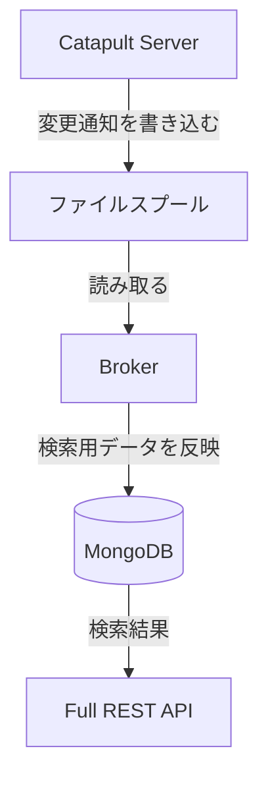
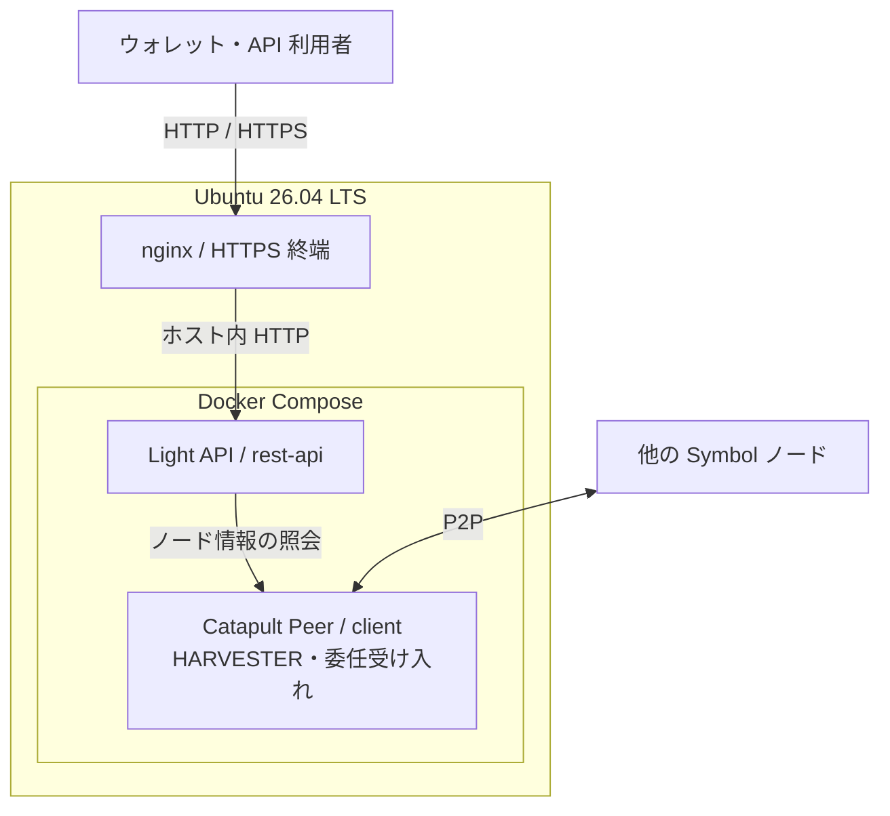

Symbol ノードでどの API を提供するかを選び、ハーベスティングや Voting に参加するかを決めます。
Peer+Light API と Peer+Full API は API の提供範囲を比較する構成です。Voting は、どちらの構成にも組み合わせられる、ファイナライズへの投票機能です。

## API の提供範囲を選ぶ

Peer は、他のノードから受け取るブロックやトランザクションを検証・中継します。そのノードに、用途に応じた API を組み合わせます。

| 比較項目 | Peer+Light API | Peer+Full API |
| --- | --- | --- |
| 主な用途 | ノード情報の公開、委任先情報の取得 | ウォレット・エクスプローラー・アプリ向けの検索 API の提供 |
| API の範囲 | ノード情報・ブロック高などの基本的な照会 | アカウント・トランザクション・履歴などの検索も提供 |
| ブロックの検証・中継 | 行う | 行う |
| ブロックチェーンの保存・同期 | 必要 | 必要 |
| 主な構成要素 | Catapult、REST Gateway(Light API) | Catapult、REST Gateway(Full API)、Broker、MongoDB |
| 必要資源 | 検索用 DB を持たない分、資源と構成要素を抑えられる | 検索用 DB と Broker の処理に応じたメモリ・ディスク容量・I/O の余裕が必要 |
| 主な保守対象 | ノード本体、Light API、公開する場合の HTTPS | 左記に加え、MongoDB と Broker の稼働・データ反映・スプールの滞留 |

Light API では `/node/info`、`/chain/info`、`/node/unlockedaccount` などを公開できます。アカウントやトランザクションの検索を必要とするアプリでは Full API を選びます。[公式のノード解説](https://docs.symboltest.net/en/textbook/nodes/#api-nodes)で、各 API の役割と対応範囲を確認できます。

本ガイドでは、Peer と Full API を組み合わせた構成を「Peer+Full API」と表記します。「Dual」は、[API とハーベスティングの役割を併用するノードの非公式な呼称](https://docs.symboltest.net/en/textbook/nodes/#harvester-nodes) です。API の提供範囲と、有効にするハーベスティング・Voting の機能は分けて選びます。

### Peer+Light API が向いている場合

ブロックの検証・中継に参加し、委任ハーベスティングを受け付ける構成で、検索用 API の提供を必要としない場合に選びます。Light API から委任先のノード情報を取得できるため、委任受け入れのために Full API 一式を動かす必要はありません。

Light API でも、Catapult が使うブロックや状態の保存・同期は必要です。ブロックを保存しないライトクライアントとは異なります。

### Peer+Full API が向いている場合

ウォレットやエクスプローラー、アプリからアカウント情報・トランザクション履歴などを検索できる API を、自分のサーバーで提供したい場合に選びます。
Catapult のデータ保存に加え、Broker と MongoDB の稼働、検索用データの反映状況も運用対象になります。

Full API でディスク I/O の余裕が必要になる理由

Full API 構成では、**Catapult Server と Broker の間の受け渡しにファイルスプールを使う**点も、運用時に考慮する必要があります。スプールは、Server が出力した変更通知を、Broker が後から読み取るために一時保存するファイル群です。[Broker の実装](https://github.com/symbol/symbol/blob/dev/client/catapult/src/catapult/local/broker/Broker.cpp) でも、変更の種類ごとにスプールを読み取る処理が確認できます。

Full API では、ノード本体のデータ保存に加え、スプールの読み書きと MongoDB の更新が発生します。**容量だけでなく、IOPS や読み書きの待ち時間にも余裕が必要**です。Broker の処理が追いつかなければスプールが滞留し、API の情報反映も遅れるため、監視対象が増えます。Peer+Light API ではこの負担を抑えられますが、ブロック・状態の保存に使うディスク I/O は必要です。

容量やメモリの数値は、対象バージョンの[公式ハードウェア要件](https://docs.symboltest.net/en/userbook/shoestring/install/)と照合してください。ブロックチェーンの増加や API のアクセス数も見込んで選びます。

## ハーベスティングと委任受け入れ

ハーベスティングはブロック生成への参加です。委任受け入れは、別のアカウントから委任を受け、そのアカウントのリモート鍵・VRF 鍵を使ってノード上でハーベストする運用です。API の種類を選ぶだけでは、これらの設定は完了しません。

Mainnet でハーベストするアカウントには、原則として 10,000 XYM 以上の残高と正のインポータンスが必要です。一方、委任を受け付けるノードのメインアカウント自身が、このハーベスト条件を満たす必要はありません。委任元の資格要件と、ノード側の受け入れ設定・空き枠を分けて確認します。[公式のハーベスティング解説](https://docs.symboltest.net/en/textbook/harvesting/)

本站の構築手順では、[おすすめの構成](#recommended-configuration)として委任受け入れ用の Peer+Light API を扱います。

## Voting を追加する

Voting ノードは、ファイナライズのための投票に参加します。ブロックを生成するハーベスティングとは役割が異なります。
Peer+Light API にも Peer+Full API にも組み合わせられ、Full API の提供は Voting の必須条件ではありません。[公式の Voting ノードの説明](https://docs.symboltest.net/en/textbook/nodes/#voting-nodes)

Mainnet の参加条件として、ノードのメインアカウントには **3,000,000 XYM 以上**が必要です。これは委任ハーベスティングを受け付けるノードの条件とは異なり、投票資格に加えて投票鍵の登録も必要です。条件と設定は[公式の Voting 構築手順](https://docs.symboltest.net/en/userbook/shoestring/quickstart/#configure-voting-optional) と、Mainnet の[ネットワーク設定](https://github.com/symbol/networks/blob/mainnet/resources/config-network.properties)を参照してください。

Voting を選ぶ場合は、投票鍵の期限管理と[定期的な更新](https://docs.symboltest.net/en/userbook/shoestring/maintain/#voting-key-renewal)も運用負担に含めます。

## おすすめの構成 {/* #recommended-configuration */}

**検索用 API を自分で提供する必要がなく、ブロックの検証・中継と委任ハーベスティングの受け入れを目的とする場合は、Peer+Light API をおすすめします。** MongoDB・Broker の保守を増やさず、委任先として必要なノード情報を公開できます。

本站の構築手順は委任受け入れ用の構成を扱い、ノードのメインアカウント自身の自動ハーベストと Voting は有効にしません。HTTPS はホスト上の nginx で終端します。
構築手順の到達点は起動と基本的な動作確認までで、同期完了・実際の委任受け入れ・ハーベスト成功の確認は範囲外です。

### 対象環境

| 項目 | 想定 |
| --- | --- |
| OS | Ubuntu 26.04 LTS(Resolute Raccoon) |
| ネットワーク | Symbol Mainnet |
| ノード | Peer+Light API+HARVESTER（委任受け入れ） |
| 構築ツール | Shoestring 0.2.4 |
| デプロイ | Docker Compose v2.24.4 以降 |
| Python | Ubuntu 標準の 3.14 系・venv・pip |

構築には、ノード用のサーバーと公開ドメインを用意します。
2026 年 10 月 18 日に確認した公式の[ハードウェア要件](https://docs.symboltest.net/en/userbook/shoestring/install/)では、Peer ノードの最低目安が **CPU 2 コア、RAM 8GB、ディスク 500GB**、推奨が **CPU 4 コア、RAM 16GB、ディスク 500GB** です。SSD のランダム I/O 性能も重要で、公式目安は 1500 IOPS です。将来のディスク使用量増加も見込んでください。

### 稼働時の構成

nginx・Light API・Peer の接続関係は次のとおりです。MongoDB・Broker・HTTPS プロキシコンテナは使用しません。

## 構築・保守の案内

| 目的 | 参照先 |
| --- | --- |
| おすすめの構成を新規構築する | [サーバーの準備](./server-preparation.mdx)から開始。以降は各記事末尾の案内に沿って、起動と基本動作確認まで進めます |
| Peer+Full API を構築する | 本站の構築手順は未整備。[公式の構築手順](https://docs.symboltest.net/en/userbook/shoestring/quickstart/)を参照 |
| Voting を追加する | 本站の設定手順は未整備。[公式の Voting 構築手順](https://docs.symboltest.net/en/userbook/shoestring/quickstart/#configure-voting-optional) を参照 |
| Mainnet と Testnet を併設する | [Mainnet と Testnet を同一ホストで運用する](./network-coexistence.mdx)。Light API/Full API の両方について通常構築からの変更点を掲載 |
| 稼働中のノードを保守する | Mainnet/Testnet 共通の[ノードの保守](./maintenance.mdx)。ログ確認、停止・再開、バックアップ、更新と復旧を掲載 |
