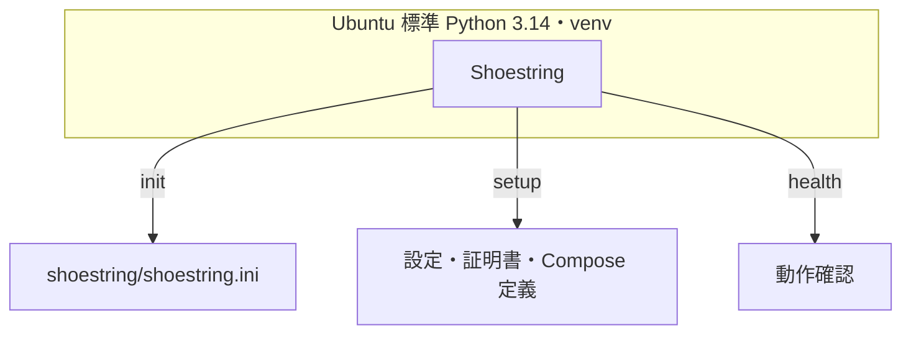

**操作ユーザー：SSH でログインした `symbol` ユーザー。作業場所：ホームディレクトリ（途中で `~/symbol-node` を作成して移動）。**

[おすすめの構成](./node-types.mdx#recommended-configuration)の対象環境を確認し、[nginx と HTTPS の設定](./nginx.mdx) まで完了してから進めてください。

## Shoestring の役割

[Shoestring](https://github.com/symbol/product/tree/dev/tools/shoestring) は、Symbol ノードの導入・設定・保守を支援する Python 製ツールです。ノードの構成を生成・管理し、実際のノードは Docker コンテナで稼働します。



## Ubuntu 標準の Python を確認する

Ubuntu 26.04 の標準 `python3`（3.14 系）を使います。`python3-venv` は[サーバーの準備](./server-preparation.mdx)で導入済みとします。

```bash
python3 --version
```

Shoestring は、標準ライブラリの `venv` で作る専用の仮想環境にインストールします。Ubuntu が管理する Python 環境へ直接 pip で追加するのではなく、ノードごとにパッケージを分離します。[Ubuntu の Python 環境の説明](https://documentation.ubuntu.com/ubuntu-for-developers/tutorials/python-use/)

## 作業ディレクトリと仮想環境を作る

Linux ユーザー名は `symbol`、ノードを配置するディレクトリ名は `symbol-node` とします。ホーム配下の `~/symbol-node` は、ホームが `/home/symbol` の場合 `/home/symbol/symbol-node` です。既にノードや Python 環境がある場合は、用途を確認し、新規構築には別のディレクトリを使ってください。

```bash
mkdir ~/symbol-node
chmod 700 ~/symbol-node
cd ~/symbol-node
umask 077
python3 -m venv .venv
source .venv/bin/activate
python -m pip install symbol-shoestring==0.2.4
python -m shoestring --help
```

以降は、**仮想環境を有効化したシェルで `python -m shoestring` を実行**します。`python -m pip` も同じ Python 環境を使います。
`init`・`setup`・`health` などのヘルプが表示されることを確認してください。

対話型のウィザードは `python -m shoestring.wizard` で起動できます。本ガイドでは、構成を把握して再現しやすいよう CLI を使います。

構築後の主な配置は次のとおりです。設定ファイルの場所はウィザードの既定値とそろえています。

```text
~/symbol-node/
├─ .venv/                        # Ubuntu 標準 Python から作る仮想環境
├─ shoestring/
│  ├─ shoestring.ini             # Shoestring の設定
│  └─ overrides.ini              # ノード固有の設定
├─ ca.key.pem                    # メインアカウントの秘密鍵（動作確認後に退避）
├─ docker-compose.yaml
├─ docker-compose.override.yaml
├─ docker-compose-recovery.yaml
├─ userconfig/
├─ keys/
├─ data/
└─ logs/
```

REST を独自設定する場合は `shoestring/rest_overrides.json` も配置します。通常の Light API 構築例では作成しません。[ウィザードの設定配置の実装](https://github.com/symbol/product/blob/0cda29ca3665e5cf9e074e8f145c6c845c6efada/tools/shoestring/shoestring/wizard/shoestring_dispatcher.py)

## バージョンと依存関係を確認する

```bash
python -c 'import sys, ssl; print(sys.executable); print(sys.version); print(ssl.OPENSSL_VERSION)'
python -c 'from importlib.metadata import version; print("symbol-shoestring:", version("symbol-shoestring")); print("symbol-lightapi:", version("symbol-lightapi"))'
python -m pip check
```

`sys.executable` がノードディレクトリの `.venv/bin/python` を指すことを確認します。`symbol-lightapi` は CLI のノード通信に使う Python パッケージで、Docker 上の Light API の版とは別です。
シェルの `openssl version` と Python の `ssl.OPENSSL_VERSION` も、それぞれの表示を記録します。依存パッケージの導入に失敗した場合は、エラー内容と[OS パッケージの準備](./server-preparation.mdx) を確認してください。

## Shoestring を日本語で表示する

```bash
LC_MESSAGES=ja python -m shoestring --help
```

この指定はそのコマンドに適用されます。同じシェルで継続する場合は `export LC_MESSAGES=ja` を使います。[Shoestring の翻訳の実装](https://github.com/symbol/product/blob/0cda29ca3665e5cf9e074e8f145c6c845c6efada/tools/shoestring/shoestring/__main__.py)

## 別のシェルで作業を再開する

`symbol` ユーザーでログインし、作業ディレクトリへ移動して仮想環境を有効化します。

```bash
cd ~/symbol-node
umask 077
source .venv/bin/activate
python --version
python -m shoestring --help
```

シェルでの作業を終えるときは `deactivate` で仮想環境を解除できます。Docker 上のノードは、シェルや仮想環境を閉じても停止しません。
Mainnet と Testnet を切り替える場合は、現在の環境を `deactivate` し、対象ディレクトリへ移動してから、その `.venv` を有効化してください。

## 次の手順

[ネットワークとノードの設定](./shoestring-config.mdx)へ進みます。
