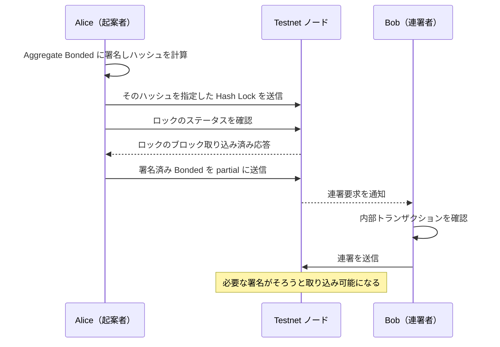

import Tabs from '@theme/Tabs';
import TabItem from '@theme/TabItem';

ハッシュロックは Aggregate Bonded の連署待ちを支える預託です。
シークレットロックは、秘密のバイト列の提示を条件に資産を受信者へ渡します。両者は用途が異なります。
[学習用アカウント](learning-accounts.mdx)を準備してください。

## 7.1 ハッシュロックと Aggregate Bonded

Alice と Bob の転送をまとめ、ネットワーク上で Bob の連署を待ちます。
最初にボンデッドを構築・署名してハッシュを決め、次にそのハッシュを指定したロックを送ります。
`/network/properties` の `plugins.lockhash` にある `lockedFundsPerAggregate` と `maxHashLockDuration` を確認します。
`HASH_LOCK_AMOUNT` には最小単位の数量、`HASH_LOCK_DURATION` には上限内のブロック数を設定してください。
通貨モザイクとロック額は、接続先のネットワーク設定に合わせます。




<Tabs groupId="language">
<TabItem value="ts" label="TypeScript">

```ts title="src/lock/prepare-bonded.ts"
import { writeFileSync } from 'node:fs';
import {
  generateMosaicAliasId,
  models,
  SymbolFacade,
  SymbolTransactionFactory,
  descriptors,
} from 'symbol-sdk/symbol';
import { alice, bob } from '../accounts/key-store.js';

// Testnet のアドレス生成・時刻・署名に使う設定を選ぶ。
const facade = new SymbolFacade('testnet');

const amount = process.env.HASH_LOCK_AMOUNT;

const duration = process.env.HASH_LOCK_DURATION;

if (!amount || !duration)
  throw new Error('HASH_LOCK_AMOUNT と HASH_LOCK_DURATION が必要です');

// 内部トランザクションには個別の期限・手数料・署名を付けない。
const transfers = [
  facade.createEmbeddedTransactionFromTypedDescriptor(
    new descriptors.TransferTransactionV1Descriptor(bob.address),
    alice.publicKey,
  ),
  facade.createEmbeddedTransactionFromTypedDescriptor(
    new descriptors.TransferTransactionV1Descriptor(alice.address),
    bob.publicKey,
  ),
];

// descriptor に署名者・手数料係数・期限を設定して構築する。
const bonded = facade.createTransactionFromTypedDescriptor(
  new descriptors.AggregateBondedTransactionV3Descriptor(
    SymbolFacade.hashEmbeddedTransactions(transfers),
    transfers,
  ),
  alice.publicKey,
  100,
  2 * 60 * 60,
  1,
) as models.AggregateBondedTransactionV3;

// 内容を確定したトランザクションに、送信者の秘密鍵で署名する。
const signature = alice.signTransaction(bonded);

// 署名やハッシュが一致しなければ処理を止める。
if (!facade.verifyTransaction(bonded, signature))
  throw new Error('署名検証に失敗しました');

// 署名を組み込み、REST APIへ送れるJSONにする。
const payload2 = SymbolTransactionFactory.attachSignature(bonded, signature);

writeFileSync('bonded.json', payload2);

// descriptor に署名者・手数料係数・期限を設定して構築する。
const lock = facade.createTransactionFromTypedDescriptor(
  new descriptors.HashLockTransactionV1Descriptor(
    new descriptors.UnresolvedMosaicDescriptor(
      new models.UnresolvedMosaicId(generateMosaicAliasId('symbol.xym')),
      new models.Amount(BigInt(amount)),
    ),
    new models.BlockDuration(BigInt(duration)),
    facade.hashTransaction(bonded),
  ),
  alice.publicKey,
  100,
  2 * 60 * 60,
);

// 内容を確定したトランザクションに、送信者の秘密鍵で署名する。
const signature2 = alice.signTransaction(lock);

// 署名やハッシュが一致しなければ処理を止める。
if (!facade.verifyTransaction(lock, signature2))
  throw new Error('署名検証に失敗しました');

// 署名を組み込み、REST APIへ送れるJSONにする。
const payload3 = SymbolTransactionFactory.attachSignature(lock, signature2);

writeFileSync('payload.json', payload3);

console.log('lockHash:', facade.hashTransaction(lock).toString());

console.log('bondedHash:', facade.hashTransaction(bonded).toString());
```

</TabItem>
<TabItem value="py" label="Python">

```py title="src/lock/prepare_bonded.py"
import os
from pathlib import Path
from symbolchain.symbol.IdGenerator import generate_mosaic_alias_id
from symbolchain.facade.SymbolFacade import SymbolFacade
from symbolchain.symbol.TransactionFactory import TransactionFactory
from accounts.key_store import alice, bob

# Testnet のアドレス生成・時刻・署名に使う設定を選ぶ。
facade = SymbolFacade('testnet')

# 内部トランザクションには個別の期限・手数料・署名を付けない。
transfers = [
    facade.create_embedded_transaction_from_descriptor(
        {'type': 'transfer_transaction_v1', 'recipient_address': bob.address},
        alice.public_key,
    ),
    facade.create_embedded_transaction_from_descriptor(
        {'type': 'transfer_transaction_v1', 'recipient_address': alice.address},
        bob.public_key,
    ),
]

# descriptor に署名者・手数料係数・期限を設定して構築する。
bonded = facade.create_transaction_from_descriptor(
    {
        'type': 'aggregate_bonded_transaction_v3',
        'transactions_hash': SymbolFacade.hash_embedded_transactions(transfers),
        'transactions': transfers,
    },
    alice.public_key,
    100,
    2 * 60 * 60,
    1,
)

# 内容を確定したトランザクションに、送信者の秘密鍵で署名する。
signature = alice.sign_transaction(bonded)

# 署名やハッシュが一致しなければ処理を止める。
if not facade.verify_transaction(bonded, signature):
    raise ValueError('署名検証に失敗しました')

# 署名を組み込み、REST APIへ送れるJSONにする。
payload = TransactionFactory.attach_signature(bonded, signature)

Path('bonded.json').write_text(payload, encoding='utf8')

# descriptor に署名者・手数料係数・期限を設定して構築する。
lock = facade.create_transaction_from_descriptor(
    {
        'type': 'hash_lock_transaction_v1',
        'hash': facade.hash_transaction(bonded),
        'mosaic': {
            'mosaic_id': generate_mosaic_alias_id('symbol.xym'),
            'amount': int(os.environ['HASH_LOCK_AMOUNT']),
        },
        'duration': int(os.environ['HASH_LOCK_DURATION']),
    },
    alice.public_key,
    100,
    2 * 60 * 60,
)

# 内容を確定したトランザクションに、送信者の秘密鍵で署名する。
signature2 = alice.sign_transaction(lock)

# 署名やハッシュが一致しなければ処理を止める。
if not facade.verify_transaction(lock, signature2):
    raise ValueError('署名検証に失敗しました')

# 署名を組み込み、REST APIへ送れるJSONにする。
payload2 = TransactionFactory.attach_signature(lock, signature2)

Path('payload.json').write_text(payload2, encoding='utf8')

print('lockHash:', facade.hash_transaction(lock))

print('bondedHash:', facade.hash_transaction(bonded))
```

</TabItem>
</Tabs>

1. [通常の送信手順](transactions.mdx#32-署名済みペイロードを送信する)で `payload.json` のロックを送信する。
2. `lockHash` の取り込みを確認する。
3. 次の例で `bonded.json` を `/transactions/partial` に送信する。
4. ボンデッドが partial キャッシュに届いてから Bob が内容を確認して連署する。
5. `bondedHash` の取り込みを確認する。

次の送信は `--announce` を指定した場合だけ実行します。`LOCK_HASH` に上で表示した `lockHash` を設定します。

<Tabs groupId="language">
<TabItem value="ts" label="TypeScript">

```ts title="src/lock/announce-bonded.ts"
import { readFileSync } from 'node:fs';
import { SymbolFacade } from 'symbol-sdk/symbol';

// Testnet のアドレス生成・時刻・署名に使う設定を選ぶ。
const facade = new SymbolFacade('testnet');

const node = process.env.SYMBOL_NODE?.replace(/\/$/, '');

// 署名済みJSONを送る前に、接続先のネットワークを照合する。
async function announce(body: string, path = '/transactions') {
  await checkNetwork();
  return request(path, 'PUT', body);
}

// 未伝播の404と失敗状態を区別し、ブロックへの取り込みを待つ。
async function waitConfirmed(hash: string, seconds = 180) {
  const until = Date.now() + seconds * 1000;
  while (Date.now() < until) {
    // 未伝播時の 404 はまだ失敗を意味しない。
    const status = await request(`/transactionStatus/${hash}`).catch((error) => {
      if (String(error).endsWith('HTTP 404')) return undefined;
      throw error;
    });
    if (status?.group === 'failed') throw new Error(status.code);
    if (status?.group === 'confirmed')
      return request(`/transactions/confirmed/${hash}`);
    await new Promise((resolve) => setTimeout(resolve, 2000));
  }
  throw new Error('取り込み待ちが期限を超えました。再送前に状態を確認してください');
}

// SDK とノードのネットワーク設定が一致することを確認する。
async function checkNetwork() {
  const info = await request('/node/info');
  const properties = await request('/network/properties');
  const seed = facade.network.generationHashSeed.toString();
  const epoch = facade.network.datetimeConverter.epoch.getTime() / 1000;
  if (
    info.networkIdentifier !== facade.network.identifier ||
    info.networkGenerationHashSeed !== seed ||
    properties.network.generationHashSeed !== seed ||
    properties.network.epochAdjustment !== `${epoch}s`
  ) {
    throw new Error('SDK と接続先の Testnet 設定が一致しません');
  }
}

// HTTPエラーを検出し、応答待ちを15秒に制限する。
async function request(path: string, method = 'GET', body?: string) {
  if (!node) throw new Error('SYMBOL_NODE に Testnet の REST URL を設定してください');
  const response = await fetch(`${node}${path}`, {
    method,
    body,
    headers: { 'Content-Type': 'application/json' },
    signal: AbortSignal.timeout(15000),
  });
  if (!response.ok) throw new Error(`${method} ${path}: HTTP ${response.status}`);
  return response.json();
}

if (!process.argv.includes('--announce')) throw new Error('--announce が必要です');

const hash = process.env.LOCK_HASH;

if (!hash) throw new Error('LOCK_HASH が必要です');

await waitConfirmed(hash);

console.log(
  await announce(readFileSync('bonded.json', 'utf8'), '/transactions/partial'),
);
```

</TabItem>
<TabItem value="py" label="Python">

```py title="src/lock/announce_bonded.py"
import os
import sys
import requests
import time
from pathlib import Path
from symbolchain.facade.SymbolFacade import SymbolFacade

# Testnet のアドレス生成・時刻・署名に使う設定を選ぶ。
facade = SymbolFacade('testnet')


# HTTPエラーを検出し、応答待ちを15秒に制限する。
def request(path, method='GET', body=None):
    node = os.environ['SYMBOL_NODE'].rstrip('/')
    response = requests.request(
        method,
        node + path,
        data=body,
        headers={'Content-Type': 'application/json'},
        timeout=15,
    )
    response.raise_for_status()
    return response.json()


# SDK とノードのネットワーク設定が一致することを確認する。
def check_network():
    info = request('/node/info')
    properties = request('/network/properties')
    seed = str(facade.network.generation_hash_seed)
    epoch = int(facade.network.datetime_converter.epoch.timestamp())
    if (
        info['networkIdentifier'] != facade.network.identifier
        or info['networkGenerationHashSeed'] != seed
        or properties['network']['generationHashSeed'] != seed
        or (properties['network']['epochAdjustment'] != f'{epoch}s')
    ):
        raise ValueError('SDK と接続先の Testnet 設定が一致しません')


# ネットワーク設定を照合してから署名済みJSONを送信する。
def announce(body, path='/transactions'):
    check_network()
    return request(path, 'PUT', body)


# 未伝播の404と失敗状態を区別し、ブロックへの取り込みを待つ。
def wait_confirmed(tx_hash, seconds=180):
    until = time.monotonic() + seconds
    while time.monotonic() < until:
        try:
            status = request(f'/transactionStatus/{tx_hash}')
        except requests.HTTPError as error:
            if error.response.status_code != 404:
                raise
            status = {}
        if status.get('group') == 'failed':
            raise ValueError(status['code'])
        if status.get('group') == 'confirmed':
            return request(f'/transactions/confirmed/{tx_hash}')
        time.sleep(2)
    raise TimeoutError('取り込み待ちが期限を超えました。再送前に状態を確認してください')


if '--announce' not in sys.argv:
    raise ValueError('--announce が必要です')

wait_confirmed(os.environ['LOCK_HASH'])

print(announce(Path('bonded.json').read_text(encoding='utf8'), '/transactions/partial'))
```

</TabItem>
</Tabs>

## 7.2 Bob が連署する

`bonded.json` の送受信者・内部トランザクション・金額・期限を確認してから実行します。
`GET /transactions/partial/{hash}` の内容とも照合してください。ハッシュだけの要求を自動で承認しません。

<Tabs groupId="language">
<TabItem value="ts" label="TypeScript">

```ts title="src/lock/cosign-bonded.ts"
import { readFileSync } from 'node:fs';
import { utils } from 'symbol-sdk';
import { models, SymbolTransactionFactory, SymbolFacade } from 'symbol-sdk/symbol';
import { alice, bob } from '../accounts/key-store.js';

// Testnet のアドレス生成・時刻・署名に使う設定を選ぶ。
const facade = new SymbolFacade('testnet');

const node = process.env.SYMBOL_NODE?.replace(/\/$/, '');

// 署名済みJSONを送る前に、接続先のネットワークを照合する。
async function announce(body: string, path = '/transactions') {
  await checkNetwork();
  return request(path, 'PUT', body);
}

// SDK とノードのネットワーク設定が一致することを確認する。
async function checkNetwork() {
  const info = await request('/node/info');
  const properties = await request('/network/properties');
  const seed = facade.network.generationHashSeed.toString();
  const epoch = facade.network.datetimeConverter.epoch.getTime() / 1000;
  if (
    info.networkIdentifier !== facade.network.identifier ||
    info.networkGenerationHashSeed !== seed ||
    properties.network.generationHashSeed !== seed ||
    properties.network.epochAdjustment !== `${epoch}s`
  ) {
    throw new Error('SDK と接続先の Testnet 設定が一致しません');
  }
}

// HTTPエラーを検出し、応答待ちを15秒に制限する。
async function request(path: string, method = 'GET', body?: string) {
  if (!node) throw new Error('SYMBOL_NODE に Testnet の REST URL を設定してください');
  const response = await fetch(`${node}${path}`, {
    method,
    body,
    headers: { 'Content-Type': 'application/json' },
    signal: AbortSignal.timeout(15000),
  });
  if (!response.ok) throw new Error(`${method} ${path}: HTTP ${response.status}`);
  return response.json();
}

// 受け取ったペイロードを復元し、署名前に内容を確認する。
const tx = SymbolTransactionFactory.deserialize(
  utils.hexToUint8(JSON.parse(readFileSync('bonded.json', 'utf8')).payload),
);

// 署名やハッシュが一致しなければ処理を止める。
if (
  tx.type.value !== models.TransactionType.AGGREGATE_BONDED.value ||
  tx.version !== 3 ||
  tx.network.value !== facade.network.identifier ||
  tx.signerPublicKey.toString() !== alice.publicKey.toString() ||
  tx.deadline.value <= facade.now().timestamp ||
  !facade.verifyTransaction(tx, tx.signature)
) {
  throw new Error('有効なボンデッド署名ではありません');
}

const aggregate = tx as models.AggregateBondedTransactionV3;

if (
  aggregate.transactionsHash.toString() !==
  facade.static.hashEmbeddedTransactions(aggregate.transactions).toString()
) {
  throw new Error('内部トランザクションのハッシュが一致しません');
}

console.log(JSON.stringify(tx.toJson(), null, 2));

// 起案者の署名済みトランザクションに対する連署を作る。
const cosignature = bob.cosignTransaction(tx, true) as models.DetachedCosignature;

const body = JSON.stringify({
  parentHash: cosignature.parentHash.toString(),
  signature: cosignature.signature.toString(),
  signerPublicKey: cosignature.signerPublicKey.toString(),
  version: cosignature.version.toString(),
});

console.log(body);

if (process.argv.includes('--announce'))
  console.log(await announce(body, '/transactions/cosignature'));
```

</TabItem>
<TabItem value="py" label="Python">

```py title="src/lock/cosign_bonded.py"
import json
import sys
import os
import requests
from pathlib import Path
from symbolchain import sc
from symbolchain.symbol.TransactionFactory import TransactionFactory
from symbolchain.facade.SymbolFacade import SymbolFacade
from accounts.key_store import alice, bob

# Testnet のアドレス生成・時刻・署名に使う設定を選ぶ。
facade = SymbolFacade('testnet')


# HTTPエラーを検出し、応答待ちを15秒に制限する。
def request(path, method='GET', body=None):
    node = os.environ['SYMBOL_NODE'].rstrip('/')
    response = requests.request(
        method,
        node + path,
        data=body,
        headers={'Content-Type': 'application/json'},
        timeout=15,
    )
    response.raise_for_status()
    return response.json()


# SDK とノードのネットワーク設定が一致することを確認する。
def check_network():
    info = request('/node/info')
    properties = request('/network/properties')
    seed = str(facade.network.generation_hash_seed)
    epoch = int(facade.network.datetime_converter.epoch.timestamp())
    if (
        info['networkIdentifier'] != facade.network.identifier
        or info['networkGenerationHashSeed'] != seed
        or properties['network']['generationHashSeed'] != seed
        or (properties['network']['epochAdjustment'] != f'{epoch}s')
    ):
        raise ValueError('SDK と接続先の Testnet 設定が一致しません')


# ネットワーク設定を照合してから署名済みJSONを送信する。
def announce(body, path='/transactions'):
    check_network()
    return request(path, 'PUT', body)


# 受け取ったペイロードを復元し、署名前に内容を確認する。
tx = TransactionFactory.deserialize(
    bytes.fromhex(json.loads(Path('bonded.json').read_text())['payload'])
)

# 署名やハッシュが一致しなければ処理を止める。
if (
    tx.type_ != sc.TransactionType.AGGREGATE_BONDED
    or tx.version != 3
    or tx.network.value != facade.network.identifier
    or (str(tx.signer_public_key) != str(alice.public_key))
    or (tx.deadline.value <= facade.now().timestamp)
    or (not facade.verify_transaction(tx, tx.signature))
):
    raise ValueError('有効なボンデッド署名ではありません')

if str(tx.transactions_hash) != str(facade.hash_embedded_transactions(tx.transactions)):
    raise ValueError('内部トランザクションのハッシュが一致しません')

print(json.dumps(tx.to_json(), indent=2))

# 起案者の署名済みトランザクションに対する連署を作る。
cosignature = bob.cosign_transaction(tx, detached=True)

body = json.dumps(
    {
        'parentHash': str(cosignature.parent_hash),
        'signature': str(cosignature.signature),
        'signerPublicKey': str(cosignature.signer_public_key),
        'version': str(cosignature.version),
    }
)

print(body)

if '--announce' in sys.argv:
    print(announce(body, '/transactions/cosignature'))
```

</TabItem>
</Tabs>

完成したボンデッドが取り込まれるとロック額が返却されます。連署がそろわずロックが失効すると預託額を失います。
ロックを先に取り込み、ボンデッドの有効期限とロックの存続期間の両方を管理してください。

## 7.3 シークレットロックとプルーフ

ランダムな proof を生成し、SHA3-256 を secret にします。ロック時には secret だけを公開し、解除時に proof を公開します。
ロックと解除のペイロードを生成します。解除ペイロードには proof が含まれるため、ロックの取り込み前に公開しません。
`secret-lock.json` または `secret-proof.json` が存在する場合は、生成前に停止します。既存データは上書きしません。

<Tabs groupId="language">
<TabItem value="ts" label="TypeScript">

```ts title="src/lock/secret-lock.ts"
import { randomBytes, createHash } from 'node:crypto';
import { existsSync, writeFileSync } from 'node:fs';
import { Hash256 } from 'symbol-sdk';
import {
  generateMosaicAliasId,
  models,
  SymbolTransactionFactory,
  SymbolFacade,
  descriptors,
} from 'symbol-sdk/symbol';
import { alice, bob } from '../accounts/key-store.js';

// Testnet のアドレス生成・時刻・署名に使う設定を選ぶ。
const facade = new SymbolFacade('testnet');

// 既存のロックとproofの組を上書きしない。
if (['secret-lock.json', 'secret-proof.json'].some((path) => existsSync(path))) {
  throw new Error(
    '既存のロックまたはプルーフがあります。別の作業ディレクトリを使ってください',
  );
}

const proof = new Uint8Array(randomBytes(32));

// proof を公開せず、SHA3-256 のハッシュだけをロックに記録する。
const secret = new Hash256(createHash('sha3-256').update(proof).digest());

const common = { recipientAddress: bob.address, secret, hashAlgorithm: 'sha3_256' };

// descriptor に署名者・手数料係数・期限を設定して構築する。
const lock = facade.createTransactionFromTypedDescriptor(
  new descriptors.SecretLockTransactionV1Descriptor(
    bob.address,
    secret,
    new descriptors.UnresolvedMosaicDescriptor(
      new models.UnresolvedMosaicId(generateMosaicAliasId('symbol.xym')),
      new models.Amount(1_000_000n),
    ),
    new models.BlockDuration(120n),
    models.LockHashAlgorithm.SHA3_256,
  ),
  alice.publicKey,
  100,
  2 * 60 * 60,
);

// descriptor に署名者・手数料係数・期限を設定して構築する。
const unlock = facade.createTransactionFromTypedDescriptor(
  new descriptors.SecretProofTransactionV1Descriptor(
    bob.address,
    secret,
    models.LockHashAlgorithm.SHA3_256,
    proof,
  ),
  alice.publicKey,
  100,
  2 * 60 * 60,
);

// 内容を確定したトランザクションに、送信者の秘密鍵で署名する。
const signature = alice.signTransaction(lock);

// 署名やハッシュが一致しなければ処理を止める。
if (!facade.verifyTransaction(lock, signature))
  throw new Error('署名検証に失敗しました');

// 署名を組み込み、REST APIへ送れるJSONにする。
const payload = SymbolTransactionFactory.attachSignature(lock, signature);

writeFileSync('secret-lock.json', payload, { flag: 'wx' });

// 内容を確定したトランザクションに、送信者の秘密鍵で署名する。
const signature2 = alice.signTransaction(unlock);

// 署名やハッシュが一致しなければ処理を止める。
if (!facade.verifyTransaction(unlock, signature2))
  throw new Error('署名検証に失敗しました');

// 署名を組み込み、REST APIへ送れるJSONにする。
const payload2 = SymbolTransactionFactory.attachSignature(unlock, signature2);

writeFileSync('secret-proof.json', payload2, { flag: 'wx', mode: 0o600 });

console.log('secret:', secret.toString());
```

</TabItem>
<TabItem value="py" label="Python">

```py title="src/lock/secret_lock.py"
import hashlib
import os
import secrets
from pathlib import Path
from symbolchain.CryptoTypes import Hash256
from symbolchain.symbol.IdGenerator import generate_mosaic_alias_id
from symbolchain.symbol.TransactionFactory import TransactionFactory
from symbolchain.facade.SymbolFacade import SymbolFacade
from accounts.key_store import alice, bob

# Testnet のアドレス生成・時刻・署名に使う設定を選ぶ。
facade = SymbolFacade('testnet')

# 既存のロックとproofの組を上書きしない。
if any((Path(path).exists() for path in ('secret-lock.json', 'secret-proof.json'))):
    raise FileExistsError(
        '既存のロックまたはプルーフがあります。別の作業ディレクトリを使ってください'
    )

proof = secrets.token_bytes(32)

# proof を公開せず、SHA3-256 のハッシュだけをロックに記録する。
secret = Hash256(hashlib.sha3_256(proof).digest())

common = {
    'recipient_address': bob.address,
    'secret': secret,
    'hash_algorithm': 'sha3_256',
}

# descriptor に署名者・手数料係数・期限を設定して構築する。
lock = facade.create_transaction_from_descriptor(
    {
        **common,
        'type': 'secret_lock_transaction_v1',
        'mosaic': {
            'mosaic_id': generate_mosaic_alias_id('symbol.xym'),
            'amount': 1000000,
        },
        'duration': 120,
    },
    alice.public_key,
    100,
    2 * 60 * 60,
)

# descriptor に署名者・手数料係数・期限を設定して構築する。
unlock = facade.create_transaction_from_descriptor(
    {**common, 'type': 'secret_proof_transaction_v1', 'proof': proof},
    alice.public_key,
    100,
    2 * 60 * 60,
)

with Path('secret-lock.json').open('x', encoding='utf8') as file:
    signature = alice.sign_transaction(lock)
    if not facade.verify_transaction(lock, signature):
        raise ValueError('署名検証に失敗しました')
    payload = TransactionFactory.attach_signature(lock, signature)
    file.write(payload)

fd = os.open('secret-proof.json', os.O_WRONLY | os.O_CREAT | os.O_EXCL, 384)

with os.fdopen(fd, 'w', encoding='utf8') as file:
    signature2 = alice.sign_transaction(unlock)
    if not facade.verify_transaction(unlock, signature2):
        raise ValueError('署名検証に失敗しました')
    payload2 = TransactionFactory.attach_signature(unlock, signature2)
    file.write(payload2)

print('secret:', secret)
```

</TabItem>
</Tabs>

`secret-proof.json` を `.gitignore` に追加します。`secret-lock.json` を通常送信して取り込みを待ち、
その後 `secret-proof.json` を通常送信すると、指定した Bob に1 XYMが渡ります。
120ブロックという期間が接続ネットワークの上限内か確認してください。期間内に解除されなければ元の所有者へ戻ります。
長時間待つ場合は proof を保管し、解除トランザクションは送信直前に新しい期限で作成します。

## 参照資料

- [速習Symbolブロックチェーン：ロック](https://github.com/TGVRock/quick_learning_symbol_v3/blob/main/08_lock.md)
- [Symbol SDK 3.3.3 の公式実装](https://github.com/symbol/symbol/tree/7c5bd51293c1202701d10daf2afcb6c060e45c30/sdk)
- [Symbol REST OpenAPI](https://symbol.github.io/symbol-openapi/v1.0.4/)
