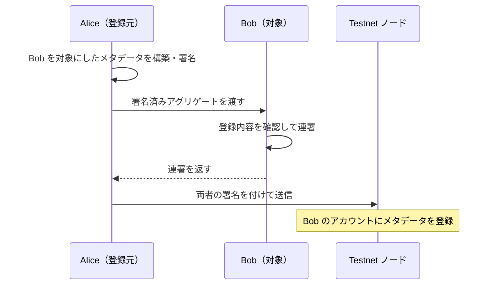

import Tabs from '@theme/Tabs';
import TabItem from '@theme/TabItem';

メタデータは「登録元・対象・キー」の組に対して値を記録します。アカウント、モザイク、ネームスペースが対象です。
同じ対象でも登録元が異なれば別のエントリです。値は公開されるため、秘密情報を記録しません。

## 6.1 アカウントへ登録・更新する

メタデータはアグリゲートに入れ、登録元と対象の承認をそろえます。
Alice が Bob に初めて登録する例では、Alice の外側署名と Bob の連署が必要です。
`valueSizeDelta` は UTF-8 **バイト数**の差分、`value` は旧値と新値の XOR 差分です。




<Tabs groupId="language">
<TabItem value="ts" label="TypeScript">

```ts title="src/metadata/account-metadata.ts"
import {
  metadataGenerateKey,
  metadataUpdateValue,
  models,
  SymbolFacade,
  SymbolTransactionFactory,
  descriptors,
} from 'symbol-sdk/symbol';
import { alice, bob } from '../accounts/key-store.js';

// Testnet のアドレス生成・時刻・署名に使う設定を選ぶ。
const facade = new SymbolFacade('testnet');

// 初回登録は旧値を空にする。更新時はチェーン上の現在値を使う。
const oldValue = new Uint8Array();

const newValue = new TextEncoder().encode('developer');

// 内部トランザクションには個別の期限・手数料・署名を付けない。
const embeddedTransactions = [
  facade.createEmbeddedTransactionFromTypedDescriptor(
    new descriptors.AccountMetadataTransactionV1Descriptor(
      bob.address,
      metadataGenerateKey('role'),
      newValue.length - oldValue.length,
      metadataUpdateValue(oldValue, newValue),
    ),
    alice.publicKey,
  ),
];

// descriptor に署名者・手数料係数・期限を設定して構築する。
const tx = facade.createTransactionFromTypedDescriptor(
  new descriptors.AggregateCompleteTransactionV3Descriptor(
    SymbolFacade.hashEmbeddedTransactions(embeddedTransactions),
    embeddedTransactions,
  ),
  alice.publicKey,
  100,
  2 * 60 * 60,
  1,
) as models.AggregateCompleteTransactionV3;

// 内容を確定したトランザクションに、送信者の秘密鍵で署名する。
const signature = alice.signTransaction(tx);

// 署名やハッシュが一致しなければ処理を止める。
if (!facade.verifyTransaction(tx, signature)) throw new Error('署名検証に失敗しました');

SymbolTransactionFactory.attachSignature(tx, signature);

// 連署を付け直して送信用JSONを生成する。手数料などの署名対象は変えない。
tx.cosignatures = [bob].map(
  (signer) => signer.cosignTransaction(tx) as models.Cosignature,
);

console.log(SymbolTransactionFactory.toJson(tx));
```

</TabItem>
<TabItem value="py" label="Python">

```py title="src/metadata/account_metadata.py"
from symbolchain.symbol.Metadata import metadata_generate_key, metadata_update_value
from symbolchain.facade.SymbolFacade import SymbolFacade
from symbolchain.symbol.TransactionFactory import TransactionFactory
from accounts.key_store import alice, bob

# Testnet のアドレス生成・時刻・署名に使う設定を選ぶ。
facade = SymbolFacade('testnet')

# 初回登録は旧値を空にする。更新時はチェーン上の現在値を使う。
old_value = b''

new_value = 'developer'.encode('utf8')

# 内部トランザクションには個別の期限・手数料・署名を付けない。
embedded_transactions = [
    facade.create_embedded_transaction_from_descriptor(
        {
            'type': 'account_metadata_transaction_v1',
            'target_address': bob.address,
            'scoped_metadata_key': metadata_generate_key('role'),
            'value_size_delta': len(new_value) - len(old_value),
            'value': metadata_update_value(old_value, new_value),
        },
        alice.public_key,
    )
]

# descriptor に署名者・手数料係数・期限を設定して構築する。
tx = facade.create_transaction_from_descriptor(
    {
        'type': 'aggregate_complete_transaction_v3',
        'transactions_hash': SymbolFacade.hash_embedded_transactions(
            embedded_transactions
        ),
        'transactions': embedded_transactions,
    },
    alice.public_key,
    100,
    2 * 60 * 60,
    1,
)

# 内容を確定したトランザクションに、送信者の秘密鍵で署名する。
signature = alice.sign_transaction(tx)

# 署名やハッシュが一致しなければ処理を止める。
if not facade.verify_transaction(tx, signature):
    raise ValueError('署名検証に失敗しました')

TransactionFactory.attach_signature(tx, signature)

# 起案者の署名済みトランザクションに対する連署を作る。
tx.cosignatures = [signer.cosign_transaction(tx) for signer in [bob]]

print(TransactionFactory.to_json(tx))
```

</TabItem>
</Tabs>

更新前には `GET /metadata` を `sourceAddress`、`targetAddress`、`scopedMetadataKey`、`metadataType` で検索します。
モザイク／ネームスペースでは `targetId` も指定します。REST の `metadataEntry.value` は16進数のバイト列です。
`utils.hexToUint8`／`bytes.fromhex` で旧値を復元してから差分を計算します。
空の旧値を使う上記例は初回専用です。再実行時は現在値との競合を確認してください。
短くする場合は負のサイズ差分、削除する場合は新値を空バイト列にします。

## 6.2 モザイクとネームスペースへ登録する

Alice が自分のモザイクとネームスペースに登録します。登録元と対象所有者が同じなので、追加の連署は不要です。
`MOSAIC_ID` と `NAMESPACE_NAME` には、前の章で登録が完了した値を設定します。

<Tabs groupId="language">
<TabItem value="ts" label="TypeScript">

```ts title="src/metadata/asset-metadata.ts"
import {
  generateNamespaceId,
  metadataGenerateKey,
  models,
  SymbolFacade,
  SymbolTransactionFactory,
  descriptors,
} from 'symbol-sdk/symbol';
import { alice } from '../accounts/key-store.js';

// Testnet のアドレス生成・時刻・署名に使う設定を選ぶ。
const facade = new SymbolFacade('testnet');

const id = process.env.MOSAIC_ID;

const name = process.env.NAMESPACE_NAME;

if (!id || !name) throw new Error('MOSAIC_ID と NAMESPACE_NAME が必要です');

const value = new TextEncoder().encode('first edition');

const common = {
  targetAddress: alice.address,
  scopedMetadataKey: metadataGenerateKey('description'),
  valueSizeDelta: value.length,
  value,
};

// 内部トランザクションには個別の期限・手数料・署名を付けない。
const embeddedTransactions = [
  facade.createEmbeddedTransactionFromTypedDescriptor(
    new descriptors.MosaicMetadataTransactionV1Descriptor(
      alice.address,
      metadataGenerateKey('description'),
      new models.UnresolvedMosaicId(BigInt(`0x${id}`)),
      value.length,
      value,
    ),
    alice.publicKey,
  ),
  facade.createEmbeddedTransactionFromTypedDescriptor(
    new descriptors.NamespaceMetadataTransactionV1Descriptor(
      alice.address,
      metadataGenerateKey('description'),
      new models.NamespaceId(generateNamespaceId(name)),
      value.length,
      value,
    ),
    alice.publicKey,
  ),
];

// descriptor に署名者・手数料係数・期限を設定して構築する。
const aggregateTransaction = facade.createTransactionFromTypedDescriptor(
  new descriptors.AggregateCompleteTransactionV3Descriptor(
    SymbolFacade.hashEmbeddedTransactions(embeddedTransactions),
    embeddedTransactions,
  ),
  alice.publicKey,
  100,
  2 * 60 * 60,
) as models.AggregateCompleteTransactionV3;

// 内容を確定したトランザクションに、送信者の秘密鍵で署名する。
const signature = alice.signTransaction(aggregateTransaction);

// 署名やハッシュが一致しなければ処理を止める。
if (!facade.verifyTransaction(aggregateTransaction, signature))
  throw new Error('署名検証に失敗しました');

// 署名を組み込み、REST APIへ送れるJSONにする。
const payload = SymbolTransactionFactory.attachSignature(
  aggregateTransaction,
  signature,
);

console.log(payload);
```

</TabItem>
<TabItem value="py" label="Python">

```py title="src/metadata/asset_metadata.py"
import os
from symbolchain.symbol.IdGenerator import generate_namespace_id
from symbolchain.symbol.Metadata import metadata_generate_key
from symbolchain.facade.SymbolFacade import SymbolFacade
from symbolchain.symbol.TransactionFactory import TransactionFactory
from accounts.key_store import alice

# Testnet のアドレス生成・時刻・署名に使う設定を選ぶ。
facade = SymbolFacade('testnet')

value = b'first edition'

common = {
    'target_address': alice.address,
    'scoped_metadata_key': metadata_generate_key('description'),
    'value_size_delta': len(value),
    'value': value,
}

# 内部トランザクションには個別の期限・手数料・署名を付けない。
embedded_transactions = [
    facade.create_embedded_transaction_from_descriptor(
        {
            **common,
            'type': 'mosaic_metadata_transaction_v1',
            'target_mosaic_id': int(os.environ['MOSAIC_ID'], 16),
        },
        alice.public_key,
    ),
    facade.create_embedded_transaction_from_descriptor(
        {
            **common,
            'type': 'namespace_metadata_transaction_v1',
            'target_namespace_id': generate_namespace_id(os.environ['NAMESPACE_NAME']),
        },
        alice.public_key,
    ),
]

# descriptor に署名者・手数料係数・期限を設定して構築する。
aggregate_tx = facade.create_transaction_from_descriptor(
    {
        'type': 'aggregate_complete_transaction_v3',
        'transactions_hash': SymbolFacade.hash_embedded_transactions(
            embedded_transactions
        ),
        'transactions': embedded_transactions,
    },
    alice.public_key,
    100,
    2 * 60 * 60,
)

# 内容を確定したトランザクションに、送信者の秘密鍵で署名する。
signature = alice.sign_transaction(aggregate_tx)

# 署名やハッシュが一致しなければ処理を止める。
if not facade.verify_transaction(aggregate_tx, signature):
    raise ValueError('署名検証に失敗しました')

# 署名を組み込み、REST APIへ送れるJSONにする。
payload = TransactionFactory.attach_signature(aggregate_tx, signature)

print(payload)
```

</TabItem>
</Tabs>

初回登録では値をそのまま指定します。更新時は対象ごとに旧値を検索し、差分を作ります。
REST で検索した内容の真正性を独立して確認するには[状態証明の検証](verify.mdx#124-状態証明を検証する)を使います。

## 参照資料

- [速習Symbolブロックチェーン：メタデータ](https://github.com/TGVRock/quick_learning_symbol_v3/blob/main/07_metadata.md)
- [Symbol SDK 3.3.3 の公式実装](https://github.com/symbol/symbol/tree/7c5bd51293c1202701d10daf2afcb6c060e45c30/sdk)
- [Symbol REST OpenAPI](https://symbol.github.io/symbol-openapi/v1.0.4/)
