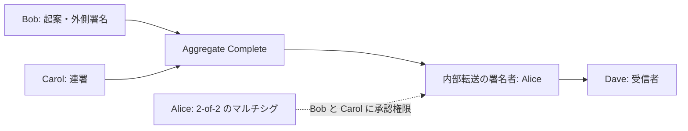

import Tabs from '@theme/Tabs';
import TabItem from '@theme/TabItem';

マルチシグ化すると、対象アカウント自身の秘密鍵だけでは操作を承認できなくなります。
この章は他の章と別の作業ディレクトリで[学習用アカウント](learning-accounts.mdx)を準備してください。
Alice を対象アカウント、Bob と Carol を連署者、Dave を送金先・追加候補にします。

## 8.1 Alice を2-of-2にする

最初の構成変更は Alice が署名し、新しく追加する Bob と Carol の同意を連署で付けます。
`minApprovalDelta` と `minRemovalDelta` は絶対値ではなく現在値からの差分です。
通常アカウントの0から2へ変更するので両方に2を指定します。

<Tabs groupId="language">
<TabItem value="ts" label="TypeScript">

```ts title="src/multisig/create-multisig.ts"
import {
  models,
  SymbolFacade,
  SymbolTransactionFactory,
  descriptors,
} from 'symbol-sdk/symbol';
import { alice, bob, carol } from '../accounts/key-store.js';

// Testnet のアドレス生成・時刻・署名に使う設定を選ぶ。
const facade = new SymbolFacade('testnet');

// 内部トランザクションには個別の期限・手数料・署名を付けない。
const modification = facade.createEmbeddedTransactionFromTypedDescriptor(
  new descriptors.MultisigAccountModificationTransactionV1Descriptor(
    2,
    2,
    [bob.address, carol.address],
    [],
  ),
  alice.publicKey,
);

const embeddedTransactions = [modification];

// descriptor に署名者・手数料係数・期限を設定して構築する。
const tx = facade.createTransactionFromTypedDescriptor(
  new descriptors.AggregateCompleteTransactionV3Descriptor(
    SymbolFacade.hashEmbeddedTransactions(embeddedTransactions),
    embeddedTransactions,
  ),
  alice.publicKey,
  100,
  2 * 60 * 60,
  2,
) as models.AggregateCompleteTransactionV3;

// 内容を確定したトランザクションに、送信者の秘密鍵で署名する。
const signature = alice.signTransaction(tx);

// 署名やハッシュが一致しなければ処理を止める。
if (!facade.verifyTransaction(tx, signature)) throw new Error('署名検証に失敗しました');

SymbolTransactionFactory.attachSignature(tx, signature);

// 連署を付け直して送信用JSONを生成する。手数料などの署名対象は変えない。
tx.cosignatures = [bob, carol].map(
  (signer) => signer.cosignTransaction(tx) as models.Cosignature,
);

console.log(SymbolTransactionFactory.toJson(tx));
```

</TabItem>
<TabItem value="py" label="Python">

```py title="src/multisig/create_multisig.py"
from symbolchain.facade.SymbolFacade import SymbolFacade
from symbolchain.symbol.TransactionFactory import TransactionFactory
from accounts.key_store import alice, bob, carol

# Testnet のアドレス生成・時刻・署名に使う設定を選ぶ。
facade = SymbolFacade('testnet')

# 内部トランザクションには個別の期限・手数料・署名を付けない。
modification = facade.create_embedded_transaction_from_descriptor(
    {
        'type': 'multisig_account_modification_transaction_v1',
        'min_approval_delta': 2,
        'min_removal_delta': 2,
        'address_additions': [bob.address, carol.address],
        'address_deletions': [],
    },
    alice.public_key,
)

embedded_transactions = [modification]

# descriptor に署名者・手数料係数・期限を設定して構築する。
tx = facade.create_transaction_from_descriptor(
    {
        'type': 'aggregate_complete_transaction_v3',
        'transactions_hash': SymbolFacade.hash_embedded_transactions(
            embedded_transactions
        ),
        'transactions': embedded_transactions,
    },
    alice.public_key,
    100,
    2 * 60 * 60,
    2,
)

# 内容を確定したトランザクションに、送信者の秘密鍵で署名する。
signature = alice.sign_transaction(tx)

# 署名やハッシュが一致しなければ処理を止める。
if not facade.verify_transaction(tx, signature):
    raise ValueError('署名検証に失敗しました')

TransactionFactory.attach_signature(tx, signature)

# 起案者の署名済みトランザクションに対する連署を作る。
tx.cosignatures = [signer.cosign_transaction(tx) for signer in [bob, carol]]

print(TransactionFactory.to_json(tx))
```

</TabItem>
</Tabs>

通常の送信手順で登録し、`GET /account/{Aliceのアドレス}/multisig` で2つの閾値と連署者を確認します。
Bob 側を同じ API で調べると `multisigAddresses` に Alice が含まれます。
以降の起案手数料は外側に署名する Bob が支払うので、Bob にも Testnet XYM を用意します。

## 8.2 マルチシグから送る

内部転送の署名者を Alice、外側の起案者を Bob にします。Alice の署名は付けません。
Bob の外側署名と Carol の連署で2-of-2を満たします。




<Tabs groupId="language">
<TabItem value="ts" label="TypeScript">

```ts title="src/multisig/transfer-multisig.ts"
import {
  generateMosaicAliasId,
  models,
  SymbolFacade,
  SymbolTransactionFactory,
  descriptors,
} from 'symbol-sdk/symbol';
import { alice, bob, carol, dave } from '../accounts/key-store.js';

// Testnet のアドレス生成・時刻・署名に使う設定を選ぶ。
const facade = new SymbolFacade('testnet');

// 内部トランザクションには個別の期限・手数料・署名を付けない。
const transfer = facade.createEmbeddedTransactionFromTypedDescriptor(
  new descriptors.TransferTransactionV1Descriptor(dave.address, [
    new descriptors.UnresolvedMosaicDescriptor(
      new models.UnresolvedMosaicId(generateMosaicAliasId('symbol.xym')),
      new models.Amount(1_000_000n),
    ),
  ]),
  alice.publicKey,
);

const embeddedTransactions = [transfer];

// descriptor に署名者・手数料係数・期限を設定して構築する。
const tx = facade.createTransactionFromTypedDescriptor(
  new descriptors.AggregateCompleteTransactionV3Descriptor(
    SymbolFacade.hashEmbeddedTransactions(embeddedTransactions),
    embeddedTransactions,
  ),
  bob.publicKey,
  100,
  2 * 60 * 60,
  1,
) as models.AggregateCompleteTransactionV3;

// 内容を確定したトランザクションに、送信者の秘密鍵で署名する。
const signature = bob.signTransaction(tx);

// 署名やハッシュが一致しなければ処理を止める。
if (!facade.verifyTransaction(tx, signature)) throw new Error('署名検証に失敗しました');

SymbolTransactionFactory.attachSignature(tx, signature);

// 連署を付け直して送信用JSONを生成する。手数料などの署名対象は変えない。
tx.cosignatures = [carol].map(
  (signer) => signer.cosignTransaction(tx) as models.Cosignature,
);

console.log(SymbolTransactionFactory.toJson(tx));
```

</TabItem>
<TabItem value="py" label="Python">

```py title="src/multisig/transfer_multisig.py"
from symbolchain.symbol.IdGenerator import generate_mosaic_alias_id
from symbolchain.facade.SymbolFacade import SymbolFacade
from symbolchain.symbol.TransactionFactory import TransactionFactory
from accounts.key_store import alice, bob, carol, dave

# Testnet のアドレス生成・時刻・署名に使う設定を選ぶ。
facade = SymbolFacade('testnet')

# 内部トランザクションには個別の期限・手数料・署名を付けない。
transfer = facade.create_embedded_transaction_from_descriptor(
    {
        'type': 'transfer_transaction_v1',
        'recipient_address': dave.address,
        'mosaics': [
            {'mosaic_id': generate_mosaic_alias_id('symbol.xym'), 'amount': 1000000}
        ],
    },
    alice.public_key,
)

embedded_transactions = [transfer]

# descriptor に署名者・手数料係数・期限を設定して構築する。
tx = facade.create_transaction_from_descriptor(
    {
        'type': 'aggregate_complete_transaction_v3',
        'transactions_hash': SymbolFacade.hash_embedded_transactions(
            embedded_transactions
        ),
        'transactions': embedded_transactions,
    },
    bob.public_key,
    100,
    2 * 60 * 60,
    1,
)

# 内容を確定したトランザクションに、送信者の秘密鍵で署名する。
signature = bob.sign_transaction(tx)

# 署名やハッシュが一致しなければ処理を止める。
if not facade.verify_transaction(tx, signature):
    raise ValueError('署名検証に失敗しました')

TransactionFactory.attach_signature(tx, signature)

# 起案者の署名済みトランザクションに対する連署を作る。
tx.cosignatures = [signer.cosign_transaction(tx) for signer in [carol]]

print(TransactionFactory.to_json(tx))
```

</TabItem>
</Tabs>

通常の送信後、取り込みと Alice・Dave の残高を確認します。
ボンデッドで集める場合も内部の署名者は Alice のままです。[ロック](lock.mdx)の手順で、
Bob が署名したボンデッドに対するロックを作り、取り込み後に Carol が連署します。

## 8.3 Carol を Dave に差し替える

前の2-of-2構成に対して、削除側の閾値を満たす Bob・Carol の承認と、新しく追加する Dave の同意が必要です。
閾値は2を保つため差分は0、外側の Bob 以外の2人分の連署領域を予約します。

<Tabs groupId="language">
<TabItem value="ts" label="TypeScript">

```ts title="src/multisig/change-cosigners.ts"
import {
  models,
  SymbolFacade,
  SymbolTransactionFactory,
  descriptors,
} from 'symbol-sdk/symbol';
import { alice, bob, carol, dave } from '../accounts/key-store.js';

// Testnet のアドレス生成・時刻・署名に使う設定を選ぶ。
const facade = new SymbolFacade('testnet');

// 内部トランザクションには個別の期限・手数料・署名を付けない。
const modification = facade.createEmbeddedTransactionFromTypedDescriptor(
  new descriptors.MultisigAccountModificationTransactionV1Descriptor(
    0,
    0,
    [dave.address],
    [carol.address],
  ),
  alice.publicKey,
);

const embeddedTransactions = [modification];

// descriptor に署名者・手数料係数・期限を設定して構築する。
const tx = facade.createTransactionFromTypedDescriptor(
  new descriptors.AggregateCompleteTransactionV3Descriptor(
    SymbolFacade.hashEmbeddedTransactions(embeddedTransactions),
    embeddedTransactions,
  ),
  bob.publicKey,
  100,
  2 * 60 * 60,
  2,
) as models.AggregateCompleteTransactionV3;

// 内容を確定したトランザクションに、送信者の秘密鍵で署名する。
const signature = bob.signTransaction(tx);

// 署名やハッシュが一致しなければ処理を止める。
if (!facade.verifyTransaction(tx, signature)) throw new Error('署名検証に失敗しました');

SymbolTransactionFactory.attachSignature(tx, signature);

// 連署を付け直して送信用JSONを生成する。手数料などの署名対象は変えない。
tx.cosignatures = [carol, dave].map(
  (signer) => signer.cosignTransaction(tx) as models.Cosignature,
);

console.log(SymbolTransactionFactory.toJson(tx));
```

</TabItem>
<TabItem value="py" label="Python">

```py title="src/multisig/change_cosigners.py"
from symbolchain.facade.SymbolFacade import SymbolFacade
from symbolchain.symbol.TransactionFactory import TransactionFactory
from accounts.key_store import alice, bob, carol, dave

# Testnet のアドレス生成・時刻・署名に使う設定を選ぶ。
facade = SymbolFacade('testnet')

# 内部トランザクションには個別の期限・手数料・署名を付けない。
modification = facade.create_embedded_transaction_from_descriptor(
    {
        'type': 'multisig_account_modification_transaction_v1',
        'min_approval_delta': 0,
        'min_removal_delta': 0,
        'address_additions': [dave.address],
        'address_deletions': [carol.address],
    },
    alice.public_key,
)

embedded_transactions = [modification]

# descriptor に署名者・手数料係数・期限を設定して構築する。
tx = facade.create_transaction_from_descriptor(
    {
        'type': 'aggregate_complete_transaction_v3',
        'transactions_hash': SymbolFacade.hash_embedded_transactions(
            embedded_transactions
        ),
        'transactions': embedded_transactions,
    },
    bob.public_key,
    100,
    2 * 60 * 60,
    2,
)

# 内容を確定したトランザクションに、送信者の秘密鍵で署名する。
signature = bob.sign_transaction(tx)

# 署名やハッシュが一致しなければ処理を止める。
if not facade.verify_transaction(tx, signature):
    raise ValueError('署名検証に失敗しました')

TransactionFactory.attach_signature(tx, signature)

# 起案者の署名済みトランザクションに対する連署を作る。
tx.cosignatures = [signer.cosign_transaction(tx) for signer in [carol, dave]]

print(TransactionFactory.to_json(tx))
```

</TabItem>
</Tabs>

1-of-1へ縮小する場合は、削除する連署者とともに両閾値の差分を `-1` にし、変更前の削除条件を満たす署名を集めます。
すべての連署者を外して通常アカウントへ戻す場合も、変更前の条件を満たす必要があります。
連署者の鍵を失って閾値を満たせなくなると、構成の復旧もできません。

## 参照資料

- [速習Symbolブロックチェーン：マルチシグ](https://github.com/TGVRock/quick_learning_symbol_v3/blob/main/09_multisig.md)
- [Symbol SDK 3.3.3 の公式実装](https://github.com/symbol/symbol/tree/7c5bd51293c1202701d10daf2afcb6c060e45c30/sdk)
- [Symbol REST OpenAPI](https://symbol.github.io/symbol-openapi/v1.0.4/)
