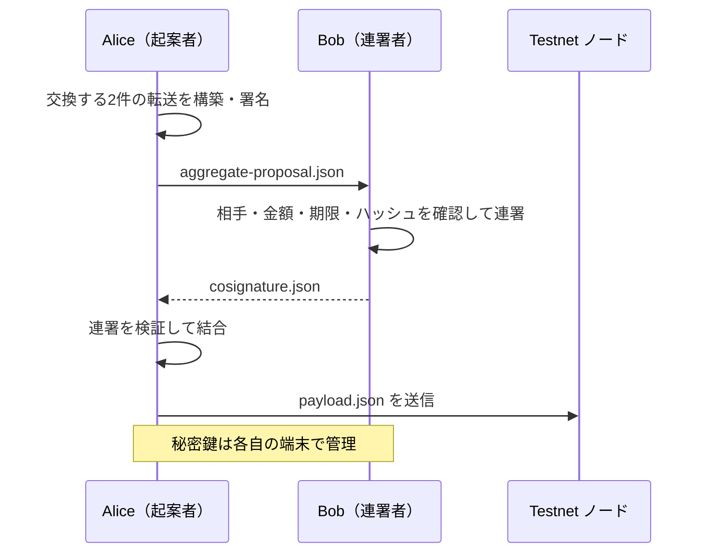

import Tabs from '@theme/Tabs';
import TabItem from '@theme/TabItem';

ネットワーク接続なしで Aggregate Complete に署名・連署し、最後にオンライン端末から送信します。
Alice と Bob が各1 XYMを交換する例です。両方の口座に残高が必要です。
学習では同じ[アカウント準備](learning-accounts.mdx)を使いますが、運用時は各担当者が自分の鍵だけを持ち、
共有するのは署名済みペイロードと連署データだけにします。




## 11.1 Alice が構築して署名する

Bob の連署1件を見込んで手数料を決めます。生成した `aggregate-proposal.json` を Bob に渡します。
Alice の署名が付いた提案データです。Bob の連署を追加するまで送信しません。

<Tabs groupId="language">
<TabItem value="ts" label="TypeScript">

```ts title="src/offline-signature/prepare-aggregate.ts"
import { writeFileSync } from 'node:fs';
import {
  generateMosaicAliasId,
  models,
  SymbolFacade,
  SymbolTransactionFactory,
  descriptors,
} from 'symbol-sdk/symbol';
import { alice, bob } from '../accounts/key-store.js';

// Testnet のアドレス生成・時刻・署名に使う設定を選ぶ。
const facade = new SymbolFacade('testnet');

const mosaics = [
  new descriptors.UnresolvedMosaicDescriptor(
    new models.UnresolvedMosaicId(generateMosaicAliasId('symbol.xym')),
    new models.Amount(1_000_000n),
  ),
];

// 内部トランザクションには個別の期限・手数料・署名を付けない。
const embeddedTransactions = [
  facade.createEmbeddedTransactionFromTypedDescriptor(
    new descriptors.TransferTransactionV1Descriptor(bob.address, mosaics),
    alice.publicKey,
  ),
  facade.createEmbeddedTransactionFromTypedDescriptor(
    new descriptors.TransferTransactionV1Descriptor(alice.address, mosaics),
    bob.publicKey,
  ),
];

// descriptor に署名者・手数料係数・期限を設定して構築する。
const tx = facade.createTransactionFromTypedDescriptor(
  new descriptors.AggregateCompleteTransactionV3Descriptor(
    SymbolFacade.hashEmbeddedTransactions(embeddedTransactions),
    embeddedTransactions,
  ),
  alice.publicKey,
  100,
  2 * 60 * 60,
  1,
) as models.AggregateCompleteTransactionV3;

// 内容を確定したトランザクションに、送信者の秘密鍵で署名する。
const signature = alice.signTransaction(tx);

// 署名やハッシュが一致しなければ処理を止める。
if (!facade.verifyTransaction(tx, signature)) throw new Error('署名検証に失敗しました');

// 署名を組み込み、REST APIへ送れるJSONにする。
const payload = SymbolTransactionFactory.attachSignature(tx, signature);

writeFileSync('aggregate-proposal.json', payload);

console.log('hash:', facade.hashTransaction(tx).toString());
```

</TabItem>
<TabItem value="py" label="Python">

```py title="src/offline_signature/prepare_aggregate.py"
from pathlib import Path
from symbolchain.symbol.IdGenerator import generate_mosaic_alias_id
from symbolchain.facade.SymbolFacade import SymbolFacade
from symbolchain.symbol.TransactionFactory import TransactionFactory
from accounts.key_store import alice, bob

# Testnet のアドレス生成・時刻・署名に使う設定を選ぶ。
facade = SymbolFacade('testnet')

mosaics = [{'mosaic_id': generate_mosaic_alias_id('symbol.xym'), 'amount': 1000000}]

# 内部トランザクションには個別の期限・手数料・署名を付けない。
embedded_transactions = [
    facade.create_embedded_transaction_from_descriptor(
        {
            'type': 'transfer_transaction_v1',
            'recipient_address': bob.address,
            'mosaics': mosaics,
        },
        alice.public_key,
    ),
    facade.create_embedded_transaction_from_descriptor(
        {
            'type': 'transfer_transaction_v1',
            'recipient_address': alice.address,
            'mosaics': mosaics,
        },
        bob.public_key,
    ),
]

# descriptor に署名者・手数料係数・期限を設定して構築する。
tx = facade.create_transaction_from_descriptor(
    {
        'type': 'aggregate_complete_transaction_v3',
        'transactions_hash': SymbolFacade.hash_embedded_transactions(
            embedded_transactions
        ),
        'transactions': embedded_transactions,
    },
    alice.public_key,
    100,
    2 * 60 * 60,
    1,
)

# 内容を確定したトランザクションに、送信者の秘密鍵で署名する。
signature = alice.sign_transaction(tx)

# 署名やハッシュが一致しなければ処理を止める。
if not facade.verify_transaction(tx, signature):
    raise ValueError('署名検証に失敗しました')

# 署名を組み込み、REST APIへ送れるJSONにする。
payload = TransactionFactory.attach_signature(tx, signature)

Path('aggregate-proposal.json').write_text(payload, encoding='utf8')

print('hash:', facade.hash_transaction(tx))
```

</TabItem>
</Tabs>

## 11.2 Bob が確認して連署する

Alice と別の経路でハッシュを照合し、内部の送受信者・金額・モザイク・ネットワーク・手数料・期限を確認します。
署名検証は Alice の署名が正しいことを確認するだけで、Bob の意図した取引かどうかは判定しません。
まず引数なしで内容を表示し、確認後に `--approve` を付けて再実行します。

<Tabs groupId="language">
<TabItem value="ts" label="TypeScript">

```ts title="src/offline-signature/cosign-aggregate.ts"
import { readFileSync, writeFileSync } from 'node:fs';
import { utils } from 'symbol-sdk';
import { models, SymbolTransactionFactory, SymbolFacade } from 'symbol-sdk/symbol';
import { alice, bob } from '../accounts/key-store.js';

// Testnet のアドレス生成・時刻・署名に使う設定を選ぶ。
const facade = new SymbolFacade('testnet');

// 受け取ったペイロードを復元し、署名前に内容を確認する。
const tx = SymbolTransactionFactory.deserialize(
  utils.hexToUint8(JSON.parse(readFileSync('aggregate-proposal.json', 'utf8')).payload),
);

// 署名やハッシュが一致しなければ処理を止める。
if (
  tx.type.value !== models.TransactionType.AGGREGATE_COMPLETE.value ||
  tx.version !== 3 ||
  tx.network.value !== facade.network.identifier ||
  tx.signerPublicKey.toString() !== alice.publicKey.toString() ||
  !facade.verifyTransaction(tx, tx.signature) ||
  tx.deadline.value <= facade.now().timestamp
) {
  throw new Error('型・起案者・ネットワーク・署名・期限を確認してください');
}

const aggregate = tx as models.AggregateCompleteTransactionV3;

if (
  aggregate.transactionsHash.toString() !==
  facade.static.hashEmbeddedTransactions(aggregate.transactions).toString()
) {
  throw new Error('内部トランザクションのハッシュが一致しません');
}

console.log(JSON.stringify(tx.toJson(), null, 2));

console.log('hash:', facade.hashTransaction(tx).toString());

if (process.argv.includes('--approve')) {
  const cosig = bob.cosignTransaction(tx, true) as models.DetachedCosignature;
  writeFileSync(
    'cosignature.json',
    JSON.stringify({
      parentHash: cosig.parentHash.toString(),
      signerPublicKey: cosig.signerPublicKey.toString(),
      signature: cosig.signature.toString(),
      version: cosig.version.toString(),
    }),
  );
}
```

</TabItem>
<TabItem value="py" label="Python">

```py title="src/offline_signature/cosign_aggregate.py"
import json
import sys
from pathlib import Path
from symbolchain import sc
from symbolchain.symbol.TransactionFactory import TransactionFactory
from symbolchain.facade.SymbolFacade import SymbolFacade
from accounts.key_store import alice, bob

# Testnet のアドレス生成・時刻・署名に使う設定を選ぶ。
facade = SymbolFacade('testnet')

# 受け取ったペイロードを復元し、署名前に内容を確認する。
tx = TransactionFactory.deserialize(
    bytes.fromhex(json.loads(Path('aggregate-proposal.json').read_text())['payload'])
)

# 署名やハッシュが一致しなければ処理を止める。
if (
    tx.type_ != sc.TransactionType.AGGREGATE_COMPLETE
    or tx.version != 3
    or tx.network.value != facade.network.identifier
    or (str(tx.signer_public_key) != str(alice.public_key))
    or (not facade.verify_transaction(tx, tx.signature))
    or (tx.deadline.value <= facade.now().timestamp)
):
    raise ValueError('型・起案者・ネットワーク・署名・期限を確認してください')

if str(tx.transactions_hash) != str(facade.hash_embedded_transactions(tx.transactions)):
    raise ValueError('内部トランザクションのハッシュが一致しません')

print(json.dumps(tx.to_json(), indent=2))

print('hash:', facade.hash_transaction(tx))

if '--approve' in sys.argv:
    cosig = bob.cosign_transaction(tx, detached=True)
    Path('cosignature.json').write_text(
        json.dumps(
            {
                'parentHash': str(cosig.parent_hash),
                'signerPublicKey': str(cosig.signer_public_key),
                'signature': str(cosig.signature),
                'version': str(cosig.version),
            }
        ),
        encoding='utf8',
    )
```

</TabItem>
</Tabs>

`cosignature.json` を Alice に返します。秘密鍵やニーモニックは渡しません。

## 11.3 Alice が連署を検証して結合する

連署対象のハッシュ、Bob の公開鍵、連署の正しさを確認してから結合します。
手数料は最初に確保した値を維持します。連署後のサイズに対して足りない場合は、再構築して両者が署名し直します。

<Tabs groupId="language">
<TabItem value="ts" label="TypeScript">

```ts title="src/offline-signature/attach-cosignature.ts"
import { readFileSync, writeFileSync } from 'node:fs';
import { PublicKey, Signature, utils } from 'symbol-sdk';
import {
  models,
  SymbolTransactionFactory,
  Verifier,
  SymbolFacade,
} from 'symbol-sdk/symbol';
import { alice, bob } from '../accounts/key-store.js';

// Testnet のアドレス生成・時刻・署名に使う設定を選ぶ。
const facade = new SymbolFacade('testnet');

// 受け取ったペイロードを復元し、署名前に内容を確認する。
const tx = SymbolTransactionFactory.deserialize(
  utils.hexToUint8(JSON.parse(readFileSync('aggregate-proposal.json', 'utf8')).payload),
) as models.AggregateCompleteTransactionV3;

const data = JSON.parse(readFileSync('cosignature.json', 'utf8'));

const hash = facade.hashTransaction(tx);

// 署名やハッシュが一致しなければ処理を止める。
if (
  tx.type.value !== models.TransactionType.AGGREGATE_COMPLETE.value ||
  tx.version !== 3 ||
  tx.signerPublicKey.toString() !== alice.publicKey.toString() ||
  !facade.verifyTransaction(tx, tx.signature) ||
  tx.transactionsHash.toString() !==
    facade.static.hashEmbeddedTransactions(tx.transactions).toString() ||
  data.parentHash !== hash.toString() ||
  data.signerPublicKey !== bob.publicKey.toString() ||
  data.version !== '0' ||
  !new Verifier(new PublicKey(data.signerPublicKey)).verify(
    hash.bytes,
    new Signature(data.signature),
  )
) {
  throw new Error('ペイロードまたは連署が一致しません');
}

const cosig = new models.Cosignature();

cosig.signerPublicKey = new models.PublicKey(utils.hexToUint8(data.signerPublicKey));

cosig.signature = new models.Signature(utils.hexToUint8(data.signature));

// 連署を付け直して送信用JSONを生成する。手数料などの署名対象は変えない。
tx.cosignatures = [cosig];

writeFileSync('payload.json', SymbolTransactionFactory.toJson(tx));

console.log('hash:', hash.toString());
```

</TabItem>
<TabItem value="py" label="Python">

```py title="src/offline_signature/attach_cosignature.py"
import json
from pathlib import Path
from symbolchain import sc
from symbolchain.CryptoTypes import PublicKey, Signature
from symbolchain.symbol.KeyPair import Verifier
from symbolchain.symbol.TransactionFactory import TransactionFactory
from symbolchain.facade.SymbolFacade import SymbolFacade
from accounts.key_store import alice, bob

# Testnet のアドレス生成・時刻・署名に使う設定を選ぶ。
facade = SymbolFacade('testnet')

# 受け取ったペイロードを復元し、署名前に内容を確認する。
tx = TransactionFactory.deserialize(
    bytes.fromhex(json.loads(Path('aggregate-proposal.json').read_text())['payload'])
)

data = json.loads(Path('cosignature.json').read_text())

tx_hash = facade.hash_transaction(tx)

# 署名やハッシュが一致しなければ処理を止める。
if (
    tx.type_ != sc.TransactionType.AGGREGATE_COMPLETE
    or tx.version != 3
    or str(tx.signer_public_key) != str(alice.public_key)
    or (not facade.verify_transaction(tx, tx.signature))
    or (
        str(tx.transactions_hash)
        != str(facade.hash_embedded_transactions(tx.transactions))
    )
    or (data['parentHash'] != str(tx_hash))
    or (data['signerPublicKey'] != str(bob.public_key))
    or (data['version'] != '0')
    or (
        not Verifier(PublicKey(data['signerPublicKey'])).verify(
            tx_hash.bytes, Signature(data['signature'])
        )
    )
):
    raise ValueError('ペイロードまたは連署が一致しません')

cosig = sc.Cosignature()

cosig.signer_public_key = sc.PublicKey(bytes.fromhex(data['signerPublicKey']))

cosig.signature = sc.Signature(bytes.fromhex(data['signature']))

# 連署を追加する。手数料などの署名対象は変えない。
tx.cosignatures = [cosig]

Path('payload.json').write_text(TransactionFactory.to_json(tx), encoding='utf8')

print('hash:', tx_hash)
```

</TabItem>
</Tabs>

最後に [通常の送信手順](transactions.mdx#32-署名済みペイロードを送信する)で `payload.json` を送ります。
Complete は全署名を集めてから送るのでハッシュロックは不要です。
オフラインで署名を集めている間も期限は進みます。期限切れなら新しい期限で再構築し、起案者・連署者とも署名し直します。

## 参照資料

- [速習Symbolブロックチェーン：オフライン署名](https://github.com/TGVRock/quick_learning_symbol_v3/blob/main/12_offline_signature.md)
- [Symbol SDK 3.3.3 の公式実装](https://github.com/symbol/symbol/tree/7c5bd51293c1202701d10daf2afcb6c060e45c30/sdk)
- [Symbol REST OpenAPI](https://symbol.github.io/symbol-openapi/v1.0.4/)
