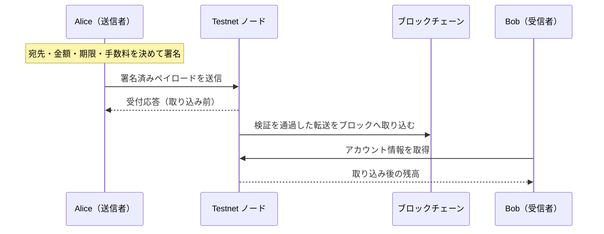
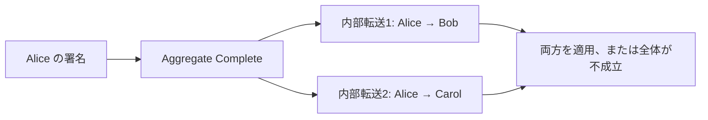

import Tabs from '@theme/Tabs';
import TabItem from '@theme/TabItem';

トランザクションは、送信者が署名した処理の要求です。XYM の転送だけでなく、モザイクの発行やメタデータの登録もトランザクションで行います。
SDK で構築・署名しただけではチェーンに記録されません。署名済みデータをノードへ送信し、検証を通過してブロックに取り込まれる必要があります。

[学習用アカウント](learning-accounts.mdx)の Alice から Bob に1 XYMを送ります。Alice に1 XYMと手数料を賄う Testnet XYM を用意してください。
通常の転送では Alice が署名し、Bob の署名は不要です。



## 3.1 転送を構築して署名する

### 処理の内容を descriptor で指定する

TypeScript は `descriptors.TransferTransactionV1Descriptor` に宛先・モザイク・メッセージを渡します。
`new models.Amount(...)` などの型を明示するため、引数の種類をコンパイル時に確認できます。
Python は `type: 'transfer_transaction_v1'` を含む辞書を descriptor として使います。
Python 3.3.3 に TypeScript と同じ descriptor クラス群はありませんが、Facade のメソッドで同じ構築手順を取れます。

| 項目 | 指定する値と役割 |
| --- | --- |
| 宛先 | Bob の Testnet アドレス。署名後に宛先を変えると署名が無効になるため、署名し直します。 |
| モザイクと数量 | `symbol.xym` のエイリアスと `1_000_000` 最小単位。XYM の可分性は6なので1 XYMです。 |
| メッセージ | UTF-8 の文字列。平文では先頭に `0x00` を付け、秘密情報を書き込みません。 |
| 署名者の公開鍵 | Alice の公開鍵。秘密鍵は構築時の descriptor に含めません。 |
| 手数料係数 | 1バイト当たりの最大手数料を計算する係数。数量は XYM の最小単位です。 |
| 有効期限までの秒数 | `2 * 60 * 60` で2時間。SDK がネットワーク時刻へ変換します。 |

### Facade でトランザクションを作る

`createTransactionFromTypedDescriptor`／`create_transaction_from_descriptor` に
「descriptor・署名者の公開鍵・手数料係数・期限までの秒数」を渡します。
ネットワーク、署名者、期限、最大手数料が設定されるため、これらを手動で組み立てる必要はありません。
OS の時刻を正しく合わせておいてください。

手数料係数100なら、転送の最大手数料は `トランザクションのサイズ × 100` です。
実際の手数料は取り込み先ブロックの係数で決まり、指定した最大手数料を超えません。
係数が不足すると取り込まれない場合があるため、`GET /network/fees/transaction` も確認します。
期限は取り込みを待てる上限で、取り込み時刻の予約ではありません。

### Alice が署名する

`signTransaction`／`sign_transaction` は Alice の秘密鍵で署名を作ります。
署名を検証してから `attachSignature`／`attach_signature` でトランザクションに組み込み、送信用の JSON を生成します。
金額や手数料などの署名対象を後から変更すると署名が無効になるため、内容を確定させてから署名してください。

<Tabs groupId="language">
<TabItem value="ts" label="TypeScript">

```ts title="src/transactions/transfer.ts"
import { writeFileSync } from 'node:fs';
import {
  descriptors,
  generateMosaicAliasId,
  models,
  SymbolFacade,
  SymbolTransactionFactory,
} from 'symbol-sdk/symbol';
import { alice, bob } from '../accounts/key-store.js';

// Testnet のアドレス生成・時刻・署名に使う設定を選ぶ。
const facade = new SymbolFacade('testnet');

// symbol.xym を未解決モザイクIDで指定し、1 XYMの転送内容を定義する。
const descriptor = new descriptors.TransferTransactionV1Descriptor(
  bob.address,
  [
    new descriptors.UnresolvedMosaicDescriptor(
      new models.UnresolvedMosaicId(generateMosaicAliasId('symbol.xym')),
      new models.Amount(1_000_000n),
    ),
  ],
  new TextEncoder().encode('\0Hello, Symbol!'),
);

// 署名者・手数料係数・2時間後の期限を設定する。まだ署名は付いていない。
const tx = facade.createTransactionFromTypedDescriptor(
  descriptor,
  alice.publicKey,
  100,
  2 * 60 * 60,
);

// Alice の秘密鍵で署名し、公開鍵で検証する。
const signature = alice.signTransaction(tx);

// 署名やハッシュが一致しなければ処理を止める。
if (!facade.verifyTransaction(tx, signature)) throw new Error('署名検証に失敗しました');

// 署名を組み込んだ送信データを保存する。保存だけではノードへ送信されない。
const body = SymbolTransactionFactory.attachSignature(tx, signature);

writeFileSync('payload.json', body);

console.log('hash:', facade.hashTransaction(tx).toString());

console.log('maxFee:', tx.fee.value.toString());
```

</TabItem>
<TabItem value="py" label="Python">

```py title="src/transactions/transfer.py"
from pathlib import Path
from symbolchain.facade.SymbolFacade import SymbolFacade
from symbolchain.symbol.IdGenerator import generate_mosaic_alias_id
from symbolchain.symbol.TransactionFactory import TransactionFactory
from accounts.key_store import alice, bob

# Testnet のアドレス生成・時刻・署名に使う設定を選ぶ。
facade = SymbolFacade('testnet')

# symbol.xym のエイリアスと、1 XYMを表す最小単位の数量を指定する。
descriptor = {
    'type': 'transfer_transaction_v1',
    'recipient_address': bob.address,
    'mosaics': [
        {'mosaic_id': generate_mosaic_alias_id('symbol.xym'), 'amount': 1_000_000}
    ],
    'message': b'\0Hello, Symbol!',
}

# 3.3.3で追加されたメソッドで、署名者・手数料・期限をまとめて設定する。
tx = facade.create_transaction_from_descriptor(
    descriptor,
    alice.public_key,
    100,
    2 * 60 * 60,
)

# Alice の秘密鍵で署名し、対応する公開鍵で検証する。
signature = alice.sign_transaction(tx)

# 署名やハッシュが一致しなければ処理を止める。
if not facade.verify_transaction(tx, signature):
    raise ValueError('署名検証に失敗しました')

# 署名済みJSONを保存する。秘密鍵はJSONに含まれない。
payload = TransactionFactory.attach_signature(tx, signature)

Path('payload.json').write_text(payload, encoding='utf8')

print('hash:', facade.hash_transaction(tx))

print('maxFee:', tx.fee.value)
```

</TabItem>
</Tabs>

```bash
# TypeScript
npx tsc
node dist/transactions/transfer.js
# Python
PYTHONPATH=src python src/transactions/transfer.py
```

`payload.json` は署名済みデータです。秘密鍵は含みませんが、期限内なら第三者も送信できます。
実行のたびに期限が変わり、別のハッシュになります。

## 3.2 署名済みペイロードを送信する

`payload.json` の `payload` は、署名を含めたトランザクションのバイト列を16進数にしたものです。
これを `PUT /transactions` に送ります。SDK の構築・署名と HTTP 通信は別の処理です。
HTTP 202などの受付応答は、ブロックへの取り込みを確約しません。

次のファイルは `--announce` を付けた場合にだけ送信します。
後続の章で表示した JSON ペイロードも `payload.json` に保存すれば同じ手順で送信できます。
受信者・金額・手数料・ネットワークを確認してから実行してください。
`SYMBOL_NODE` には[残高の確認](accounts.mdx#25-残高を確認する)で使った Testnet ノードの REST URL を設定します。
ネットワーク識別子・generation hash seed・epoch が SDK の Testnet と一致しない場合は停止します。
実ノードへのトランザクション送信は未検証です。

<Tabs groupId="language">
<TabItem value="ts" label="TypeScript">

```ts title="src/transactions/announce.ts"
import { readFileSync } from 'node:fs';
import { SymbolFacade } from 'symbol-sdk/symbol';

// Testnet のアドレス生成・時刻・署名に使う設定を選ぶ。
const facade = new SymbolFacade('testnet');

const node = process.env.SYMBOL_NODE?.replace(/\/$/, '');

// 署名済みJSONを送る前に、接続先のネットワークを照合する。
async function announce(body: string, path = '/transactions') {
  await checkNetwork();
  return request(path, 'PUT', body);
}

// SDK とノードのネットワーク設定が一致することを確認する。
async function checkNetwork() {
  const info = await request('/node/info');
  const properties = await request('/network/properties');
  const seed = facade.network.generationHashSeed.toString();
  const epoch = facade.network.datetimeConverter.epoch.getTime() / 1000;
  if (
    info.networkIdentifier !== facade.network.identifier ||
    info.networkGenerationHashSeed !== seed ||
    properties.network.generationHashSeed !== seed ||
    properties.network.epochAdjustment !== `${epoch}s`
  ) {
    throw new Error('SDK と接続先の Testnet 設定が一致しません');
  }
}

// HTTPエラーを検出し、応答待ちを15秒に制限する。
async function request(path: string, method = 'GET', body?: string) {
  if (!node) throw new Error('SYMBOL_NODE に Testnet の REST URL を設定してください');
  const response = await fetch(`${node}${path}`, {
    method,
    body,
    headers: { 'Content-Type': 'application/json' },
    signal: AbortSignal.timeout(15000),
  });
  if (!response.ok) throw new Error(`${method} ${path}: HTTP ${response.status}`);
  return response.json();
}

if (!process.argv.includes('--announce'))
  throw new Error('送信には --announce が必要です');

console.log(await announce(readFileSync('payload.json', 'utf8')));
```

</TabItem>
<TabItem value="py" label="Python">

```py title="src/transactions/announce.py"
import sys
import os
import requests
from pathlib import Path
from symbolchain.facade.SymbolFacade import SymbolFacade

# Testnet のアドレス生成・時刻・署名に使う設定を選ぶ。
facade = SymbolFacade('testnet')


# HTTPエラーを検出し、応答待ちを15秒に制限する。
def request(path, method='GET', body=None):
    node = os.environ['SYMBOL_NODE'].rstrip('/')
    response = requests.request(
        method,
        node + path,
        data=body,
        headers={'Content-Type': 'application/json'},
        timeout=15,
    )
    response.raise_for_status()
    return response.json()


# SDK とノードのネットワーク設定が一致することを確認する。
def check_network():
    info = request('/node/info')
    properties = request('/network/properties')
    seed = str(facade.network.generation_hash_seed)
    epoch = int(facade.network.datetime_converter.epoch.timestamp())
    if (
        info['networkIdentifier'] != facade.network.identifier
        or info['networkGenerationHashSeed'] != seed
        or properties['network']['generationHashSeed'] != seed
        or (properties['network']['epochAdjustment'] != f'{epoch}s')
    ):
        raise ValueError('SDK と接続先の Testnet 設定が一致しません')


# ネットワーク設定を照合してから署名済みJSONを送信する。
def announce(body, path='/transactions'):
    check_network()
    return request(path, 'PUT', body)


if '--announce' not in sys.argv:
    raise ValueError('送信には --announce が必要です')

print(announce(Path('payload.json').read_text(encoding='utf8')))
```

</TabItem>
</Tabs>

```bash
node dist/transactions/announce.js --announce
# または
PYTHONPATH=src python src/transactions/announce.py --announce
```

## 3.3 取り込みと履歴を確認する

転送の生成時に表示したハッシュを `TX_HASH` に設定します。
`unconfirmed` は未承認、`confirmed` はブロック取り込み済みです。`failed` の場合は `code` を調べます。
取り込み後のファイナライズは別に確認します。

| 状態 | 分かること | 次に確認すること |
| --- | --- | --- |
| 未伝播・404 | 問い合わせたノードでまだ見つからない | ハッシュと接続先を確認し、時間を置いて再取得する |
| `unconfirmed` | ノードが未承認として保持している | ブロックへの取り込みを待つ |
| `failed` | ノードの検証で失敗した | `code` と金額・残高・手数料・期限などを照合する |
| `confirmed` | ブロックに取り込まれた | `meta.height` と、必要ならファイナライズ高を確認する |

`confirmed` の段階とファイナライズ後では、チェーン分岐に対する確実性が異なります。
待機がタイムアウトしても失敗と断定せず、状態を確認してから再送を判断してください。

<Tabs groupId="language">
<TabItem value="ts" label="TypeScript">

```ts title="src/transactions/confirm.ts"
import { alice } from '../accounts/key-store.js';

const node = process.env.SYMBOL_NODE?.replace(/\/$/, '');

// HTTPエラーを検出し、応答待ちを15秒に制限する。
async function request(path: string, method = 'GET', body?: string) {
  if (!node) throw new Error('SYMBOL_NODE に Testnet の REST URL を設定してください');
  const response = await fetch(`${node}${path}`, {
    method,
    body,
    headers: { 'Content-Type': 'application/json' },
    signal: AbortSignal.timeout(15000),
  });
  if (!response.ok) throw new Error(`${method} ${path}: HTTP ${response.status}`);
  return response.json();
}

// 未伝播の404と失敗状態を区別し、ブロックへの取り込みを待つ。
async function waitConfirmed(hash: string, seconds = 180) {
  const until = Date.now() + seconds * 1000;
  while (Date.now() < until) {
    // 未伝播時の 404 はまだ失敗を意味しない。
    const status = await request(`/transactionStatus/${hash}`).catch((error) => {
      if (String(error).endsWith('HTTP 404')) return undefined;
      throw error;
    });
    if (status?.group === 'failed') throw new Error(status.code);
    if (status?.group === 'confirmed')
      return request(`/transactions/confirmed/${hash}`);
    await new Promise((resolve) => setTimeout(resolve, 2000));
  }
  throw new Error('取り込み待ちが期限を超えました。再送前に状態を確認してください');
}

const hash = process.env.TX_HASH;

if (!hash) throw new Error('TX_HASH を設定してください');

const confirmed = await waitConfirmed(hash);

console.log(confirmed);

const chain = await request('/chain/info');

console.log(
  'finalized:',
  BigInt(confirmed.meta.height) <= BigInt(chain.latestFinalizedBlock.height),
);

const query = new URLSearchParams({
  address: alice.address.toString(),
  order: 'desc',
  pageSize: '10',
});

console.log(await request(`/transactions/confirmed?${query}`));
```

</TabItem>
<TabItem value="py" label="Python">

```py title="src/transactions/confirm.py"
import os
import requests
import time
from urllib.parse import urlencode
from accounts.key_store import alice


# HTTPエラーを検出し、応答待ちを15秒に制限する。
def request(path, method='GET', body=None):
    node = os.environ['SYMBOL_NODE'].rstrip('/')
    response = requests.request(
        method,
        node + path,
        data=body,
        headers={'Content-Type': 'application/json'},
        timeout=15,
    )
    response.raise_for_status()
    return response.json()


# 未伝播の404と失敗状態を区別し、ブロックへの取り込みを待つ。
def wait_confirmed(tx_hash, seconds=180):
    until = time.monotonic() + seconds
    while time.monotonic() < until:
        try:
            status = request(f'/transactionStatus/{tx_hash}')
        except requests.HTTPError as error:
            if error.response.status_code != 404:
                raise
            status = {}
        if status.get('group') == 'failed':
            raise ValueError(status['code'])
        if status.get('group') == 'confirmed':
            return request(f'/transactions/confirmed/{tx_hash}')
        time.sleep(2)
    raise TimeoutError('取り込み待ちが期限を超えました。再送前に状態を確認してください')


confirmed = wait_confirmed(os.environ['TX_HASH'])

print(confirmed)

chain = request('/chain/info')

print(
    'finalized:',
    int(confirmed['meta']['height']) <= int(chain['latestFinalizedBlock']['height']),
)

query = urlencode({'address': str(alice.address), 'order': 'desc', 'pageSize': 10})

print(request(f'/transactions/confirmed?{query}'))
```

</TabItem>
</Tabs>

履歴はページ分割されます。続きは `pageNumber` を増やして取得します。
`latestFinalizedBlock.height` との比較は接続ノードの報告に基づく観測です。独立した証明検証は[検証](verify.mdx)で区別します。

## 3.4 アグリゲートにまとめる

アグリゲートは複数の処理を一つにまとめ、全体が成立する場合にまとめて適用します。
内部トランザクションの一部だけを成功させることはできません。
内部には個別の手数料・期限・署名を付けず、各処理の署名者の公開鍵を指定します。


Alice が署名する2件の転送なら、外側の Alice の署名だけで必要な署名を満たせます。
内部トランザクションは `createEmbeddedTransactionFromTypedDescriptor`／`create_embedded_transaction_from_descriptor` で作成します。
配列から `hashEmbeddedTransactions`／`hash_embedded_transactions` を計算し、外側の descriptor に設定します。
追加の連署が必要な場合は、構築メソッドの第5引数に必要な連署の総数を指定します。
SDK は1件につき104バイトを見込み、descriptor にすでに入っている連署と二重計上しないよう手数料を計算します。
署名後に手数料・期限・内部トランザクションを書き換えた場合は、構築し直して署名を集め直してください。

<Tabs groupId="language">
<TabItem value="ts" label="TypeScript">

```ts title="src/transactions/aggregate-transfer.ts"
import {
  models,
  SymbolFacade,
  SymbolTransactionFactory,
  descriptors,
} from 'symbol-sdk/symbol';
import { alice, bob, carol } from '../accounts/key-store.js';

// Testnet のアドレス生成・時刻・署名に使う設定を選ぶ。
const facade = new SymbolFacade('testnet');

// 内部トランザクションには個別の期限・手数料・署名を付けない。
const transactions = [bob, carol].map((account) =>
  facade.createEmbeddedTransactionFromTypedDescriptor(
    new descriptors.TransferTransactionV1Descriptor(
      account.address,
      undefined,
      new TextEncoder().encode('\0aggregate'),
    ),
    alice.publicKey,
  ),
);

// descriptor に署名者・手数料係数・期限を設定して構築する。
const tx = facade.createTransactionFromTypedDescriptor(
  new descriptors.AggregateCompleteTransactionV3Descriptor(
    SymbolFacade.hashEmbeddedTransactions(transactions),
    transactions,
  ),
  alice.publicKey,
  100,
  2 * 60 * 60,
) as models.AggregateCompleteTransactionV3;

// 内容を確定したトランザクションに、送信者の秘密鍵で署名する。
const signature = alice.signTransaction(tx);

// 署名やハッシュが一致しなければ処理を止める。
if (!facade.verifyTransaction(tx, signature)) throw new Error('署名検証に失敗しました');

// 署名を組み込み、REST APIへ送れるJSONにする。
const payload = SymbolTransactionFactory.attachSignature(tx, signature);

console.log(payload);
```

</TabItem>
<TabItem value="py" label="Python">

```py title="src/transactions/aggregate_transfer.py"
from symbolchain.facade.SymbolFacade import SymbolFacade
from symbolchain.symbol.TransactionFactory import TransactionFactory
from accounts.key_store import alice, bob, carol

# Testnet のアドレス生成・時刻・署名に使う設定を選ぶ。
facade = SymbolFacade('testnet')

# 内部トランザクションには個別の期限・手数料・署名を付けない。
transactions = [
    facade.create_embedded_transaction_from_descriptor(
        {
            'type': 'transfer_transaction_v1',
            'recipient_address': account.address,
            'message': b'\x00aggregate',
        },
        alice.public_key,
    )
    for account in (bob, carol)
]

# descriptor に署名者・手数料係数・期限を設定して構築する。
tx = facade.create_transaction_from_descriptor(
    {
        'type': 'aggregate_complete_transaction_v3',
        'transactions_hash': SymbolFacade.hash_embedded_transactions(transactions),
        'transactions': transactions,
    },
    alice.public_key,
    100,
    2 * 60 * 60,
)

# 内容を確定したトランザクションに、送信者の秘密鍵で署名する。
signature = alice.sign_transaction(tx)

# 署名やハッシュが一致しなければ処理を止める。
if not facade.verify_transaction(tx, signature):
    raise ValueError('署名検証に失敗しました')

# 署名を組み込み、REST APIへ送れるJSONにする。
payload = TransactionFactory.attach_signature(tx, signature)

print(payload)
```

</TabItem>
</Tabs>

必要な署名がそろった `aggregate_complete_transaction_v3` を通常の `/transactions` に送ります。
別の担当者の署名が必要な場合は[オフライン署名](offline-signature.mdx)、ネットワーク上で連署を集める場合は[ロック](lock.mdx)に進みます。
接続先は aggregate v3 に対応している必要があります。SDK で生成できるトランザクションでも、接続先が未対応のバージョンは受理されません。

## 3.5 SDK 3.3.3 の構築メソッドと手数料計算

Python 3.3.3 では次の2メソッドが追加されました。TypeScript では既存の型付き descriptor 用メソッドを使い、両言語で構築の流れをそろえられます。

| 用途 | TypeScript | Python 3.3.3で追加 |
| --- | --- | --- |
| 通常・外側トランザクションの構築 | `createTransactionFromTypedDescriptor` | `create_transaction_from_descriptor` |
| 内部トランザクションの構築 | `createEmbeddedTransactionFromTypedDescriptor` | `create_embedded_transaction_from_descriptor` |

TypeScript の3.3.3では、連署サイズにも手数料係数を掛けるよう手数料計算が修正されました。Python にも同じ修正が含まれます。
`calculateTransactionFee`／`calculate_transaction_fee` は3.3.2で追加された関数で、3.3.3の修正版を利用できます。
計算式は `(現在のサイズ + 追加する連署のサイズ) × 手数料係数` です。
この関数の連署件数は**これから追加する件数**であり、Facade の構築メソッドへ渡す総数とは区別してください。
構築時に設定した最大手数料を変更した場合は、署名も集め直します。

## 参照資料

- [速習Symbolブロックチェーン：トランザクション](https://github.com/TGVRock/quick_learning_symbol_v3/blob/main/04_transaction.md)
- [Symbol SDK 3.3.3 の公式実装](https://github.com/symbol/symbol/tree/7c5bd51293c1202701d10daf2afcb6c060e45c30/sdk)
- [Symbol REST OpenAPI](https://symbol.github.io/symbol-openapi/v1.0.4/)
- [Python SDK 3.3.3 の変更履歴](https://github.com/symbol/symbol/blob/7c5bd51293c1202701d10daf2afcb6c060e45c30/sdk/python/CHANGELOG.md#333---31-aug-2026)
- [TypeScript / JavaScript SDK 3.3.3 の変更履歴](https://github.com/symbol/symbol/blob/7c5bd51293c1202701d10daf2afcb6c060e45c30/sdk/javascript/CHANGELOG.md#333---31-aug-2026)
